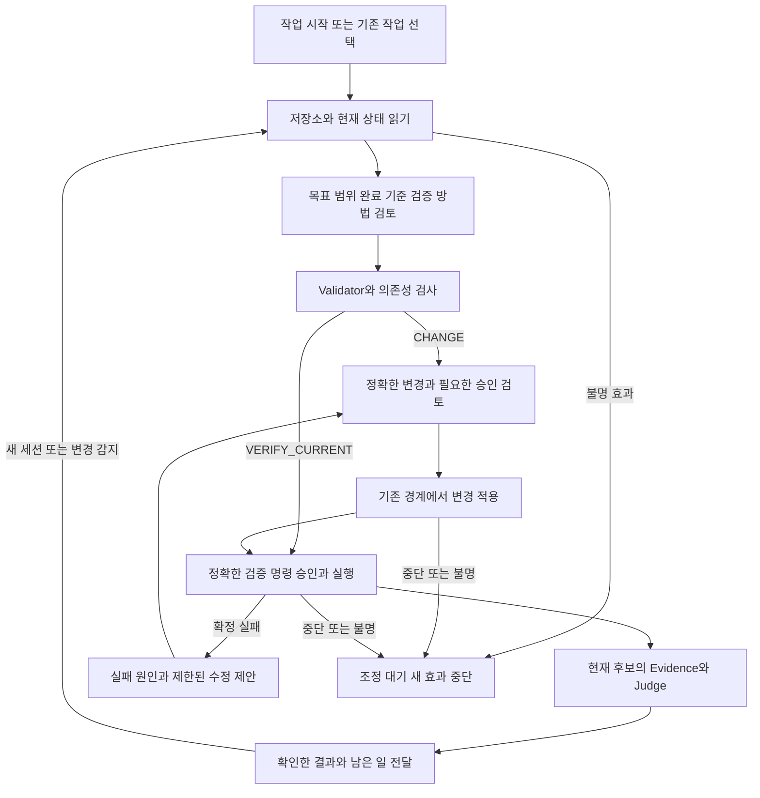

# CodeFleet 개발 작업 검증과 재개 전체 설계

상태: **IMPLEMENTED_CANDIDATE / NOT_ACCEPTED**. 설계 revision: **3**. 작성일: 2026-11-13. 설계 기준 커밋: `b3f8b985a903fd255983da01d6f284df3dea14aa`. 구현 후보: `875182f`. 구현과 시험의 실제 범위는 진행 현황을 따른다. Host Live·운영 수용을 뜻하지 않는다.

## 제품 방향과 설계의 효력

첫 제품 경험을 **기존 Host에 맡긴 개발 작업의 변경·검증·남은 일을 확인하고, 중단 후 실제 상태에서 이어가는 것**에 집중한다. 사용자는 작업 시작, 진행·재개, 결과 확인을 중심으로 사용한다. 내부 Task·DAG·revision·lease·Evidence는 유지하면서 사용자가 식별자와 명령을 직접 조립하는 부담을 줄인다.

이 설계는 [제품 원칙](../PRODUCT_VISION.md), [아키텍처](../product-completion/architecture.md), [로드맵](../product-completion/roadmap.md)에 연결된 revision 3 구현 계약이다. 승인된 운영 전 범위에서 구현 후보를 마련했으며 기존 Task 계약과 보호 게이트는 유지한다. 아래의 새 표시·연결·관측 처리는 Host Live·보호 실행·운영 수용 완료 선언이 아니다. 실제 구현·검증 상태는 [진행 현황](../../project/PROGRESS.md)에서 관리한다.

설계 검토와 구현 승인은 분리한다. 소유자는 2026-11-13 운영 전 작업 2~7 구현과 이어지는 8~10 검증을 요청했다. 이 승인은 기존 운영 Task의 임의 재개·이관·권한 확대나 공개 배포를 허용하지 않는다. 구현 후보·시험·Host Live의 실제 상태는 진행 현황에 기록한다.

이 문서에서 닫힌 설계는 **초기 프로필에 들어온 모든 입력을 허용된 다음 행동, 명시적 대기, 또는 재개할 수 없는 종료로 분류할 수 있는 설계**를 뜻한다. 모든 장애를 복구한다는 뜻은 아니다. 아래 프로필·입출력·상태 판정·종결·호환성·수락 기준은 구현자가 제품 결정을 다시 내리지 않도록 고정한다. 수용하지 않는 입력은 거부하며 향후 기능을 전제로 진행하지 않는다.

## 첫 제품의 범위

| 항목 | 초기 선택 | 보류하거나 별도 경로로 유지할 것 |
| --- | --- | --- |
| 사용자 | Codex CLI 또는 Claude Code로 기존 코드를 수정하는 개발자 | 비개발자용 완전 자동 제작, 조직 승인 시스템 |
| 대상 | Git 기준과 초기 파일 상태를 확인할 수 있는 저장소 하나, Objective 하나, 단일 Agent | 여러 저장소, 경합하는 Objective의 동시 실행, Multi-Agent 확장 |
| 실행 | 현재 Host가 추론·제안을 담당하고, 기존 감독형 Fileset 적용·검증 경계를 사용. 소스 변경 WorkItem 최대 하나와 통합 검증 WorkItem 하나 | Host 직접 편집 자동 채택, 공개 자율 실행, 별도 모델 프로세스 자동 시작 |
| 검증 | 사용자가 생성 시 선택한 LOCAL_ONLY와 지원하는 고정 Node 테스트 | 임의 빌드·브라우저 검증을 통과로 간주하기, 보호 계약의 자동 Local 전환 |
| 완료 | 현재 계약·후보의 유효한 Local 판정과 실제 확인 범위를 함께 표시 | 화면 품질·취향·사업 성과를 포함한 일괄 완료 |
| 지속성 | 효과가 확정된 세션 경계에서 같은 기록으로 재개. 불명 실행은 미해결 종료 | 불명 실행의 강제 복구, 새 Goal 엔진·상태 DB·독자 Host 압축·무한 재시도 |

Codex의 선택한 환경에서 먼저 실증하고, Claude는 같은 제품 계약으로 별도 수용한다. 한 Host나 OS의 성공을 양쪽 Host·전체 플랫폼의 성공으로 표시하지 않는다. Bootstrap·Container·Legacy·선택적 직접 API는 기존 계약대로 보존하되 초기 주 사용 경로를 늘리는 근거로 삼지 않는다.

## 전체 흐름과 책임

| 책임 | 담당 | 유지할 경계 |
| --- | --- | --- |
| 대화·질문·코드 이해·수정 제안 | 현재 Host 세션과 Skill | 제안·자기 보고에 실행 권한이나 증거 권한을 부여하지 않음 |
| 목표·완료 기준 보존 | 기존 Task·Draft·Validator | 불명확한 요구·신뢰 수준을 추론으로 확정하지 않음 |
| 적격 작업 선택 | 기존 Workflow·Controller | 새 스케줄러를 추가하지 않음 |
| 승인·예약·lease·예산 | 기존 Native Local·Reservation·Store | Host 권한과 CodeFleet 승인을 서로 대체하지 않음 |
| 실행 관측·검증 | 선택한 기존 Backend | 동일 사용자 Local의 한계를 유지 |
| 완료 판단 | 기존 Local acceptance 또는 해당 Judge | 현재성과 계약·후보·증거 결합을 검사 |
| 진행 설명·재개 안내 | 기존 report·Recovery·Work Log의 표시 계층 | 설명용 상태에서 실행이나 승인을 만들지 않음 |

이 제품의 초기 신뢰 모델은 협조적인 동일 사용자 Local 작업이다. 같은 사용자 권한으로 Host·코드·DB를 악의적으로 수정하는 주체에 대한 격리나 독립 Owner 인증을 제공하지 않는다. 별도 터미널·hash·승인 문자열만으로 그런 보장이 생기지 않는다. 보호 수준이 필요한 작업은 기존 Protected 경로와 실제 집행 수용을 요구하며, 준비되지 않으면 차단한다.

## 공통 상태와 보존 규칙

### 정상 실패 불명의 의미

정상은 필요한 전제가 충족되고 효과와 기록의 일치를 관측한 경우다. 실패는 실행 실패 또는 전제 불충족이 확인된 경우다. 불명은 실행 여부·부분 효과·기록 정합성·소유권을 확정할 수 없는 경우다. 타임아웃이나 예외만으로 효과가 없었다고 판단하지 않는다.

같은 오류라도 실행 전 거부와 실행 후 응답 유실은 다르다. 확정된 실패에도 부작용이 남을 수 있으므로 실패를 자동 롤백·재실행 허가로 바꾸지 않는다.

### 사용자 표시와 내부 상태

표시는 기존 상태에서 도출하며 별도 영속 상태 머신을 만들지 않는다. **진행 상태, 검증 수준, 필요한 행동**을 분리한다.

| 표시 | 도출 조건 | 가능한 다음 행동 |
| --- | --- | --- |
| 계획 중 | Draft·검증 방법이 미확정 | 읽기·질문·제안 |
| 진행 중 | 현재 계약에 미완료 적격 WorkItem이 있음 | 현재 권한 범위의 다음 단계 |
| 확인 대기 | 필요한 결정·정확한 승인·Capability가 부족 | 대상과 영향을 설명하고 대기 |
| 검증 실패 | 확정 실패 결과가 있음 | 근거 보존 후 수정 가능성 검사 |
| 조정 대기 | 실행·효과·lease가 불명확하거나 기록이 모순됨 | 읽기 조사만 허용하고 새 효과 중단 |
| 재검증 필요 | 현재 후보와 과거 증거가 일치하지 않음 | 차이의 채택 가능성을 먼저 확인한 뒤 새 검증 검토 |
| Local 검증 완료 | 현재 계약의 기존 LOCAL_ONLY Judge가 성립 | 확인 범위·미확인 사항 전달. 자동 Git 작업 없음 |
| 일시정지 또는 취소 | 사용자 지시와 기존 제어 기록이 있음 | 새 dispatch 중단, 진행 중 효과 확인 |

내부 `COMPLETE_LOCAL`, `UNPROTECTED`, `UNSATISFIED`, `PROVIDER_REPORTED_ONLY`, `CAPABILITY_GAP`, `EVIDENCE_DEFECT`의 의미는 변경하지 않는다.

표시 우선순위는 증거 결함·불명 효과·소유권 모순, 취소·정지, 오래된 후보, 검증 실패, 확인 대기, 진행 중, 완료 순서다. 취소 중 불명 효과가 있으면 “취소됨, 효과 조정 대기”를 함께 표시한다. 과거 완료 기록이 현재 차단을 가리지 못하게 한다.

### 보존할 데이터

| 데이터 | 기존 저장 경계 | 변경·보존 규칙 |
| --- | --- | --- |
| 원요청·중요 선택 | Task·plan artifact·directive | 원문과 채택 revision 보존. 기존 revision 또는 새 Task로 변경 |
| 저장소·기준·초기 변경 | Git probe·baseline·candidate digest | 시작 전 dirty/untracked 내용 보존. 정리를 이유로 삭제하지 않음 |
| 범위·완료 기준·테스트 대응 | Draft·Workflow artifact | 구버전 참조 보존. 검증 도중 기준을 덮어쓰지 않음 |
| 승인·신뢰 수준 | Native review·Decision·기존 승인 행 | 정확한 결합·기한·철회·소비 유지. 대화에서 승인 행을 합성하지 않음 |
| 실행·소비량 | Attempt·Reservation·lease·event | 중단·실패 후에도 소비 보존. 세션 변경으로 예산 복구 금지 |
| 관측·결과 | 기존 Evidence artifact·적용 receipt | 관측 주체·계약·후보·환경·명령·종료 코드 결합 |
| 재개·설명 | Recovery·Work Log 읽기 투영 | 별도 요약 DB 없이 기초 기록을 다시 확인 |

추가 데이터는 아래 데이터 계약의 기존 artifact·event·Task 필드·extension 표식에 한정한다. 새 테이블·DB를 만들지 않는다. 비밀 파일·인증정보·원시 세션 대화를 수집하거나 공개하지 않는다. 바이너리·symlink·과대 파일·미지원 경로는 조용히 제외한 뒤 완료시키지 않고, 검사 경계와 이유를 보여주고 영향 작업을 멈춘다.

snapshot 대상에 민감 파일이 포함돼 안전한 취급을 확정할 수 없으면 수집 전에 확인 대기로 둔다. 편의상 hash 대상을 줄여 동일한 검증 수준이라고 주장하지 않는다. 테스트 출력에 민감 정보가 있을 수 있으므로 원출력과 State는 로컬 검토 범위에 두고 공개 보고에는 별도 정제본만 사용한다. 정제본을 원 Evidence로 대체하거나 원본 digest를 다시 써서 무결성을 만들지 않는다.

### 효과 확정과 중단 원칙

읽기, 리뷰 준비, 승인, 실행, 결과 확정은 별도 작업이다. 정확한 실행 결합을 기존 transaction에서 예약한 뒤 효과를 시작하고, 결과 저장 후 현재 revision과 fence를 다시 검사해 확정한다. artifact 저장과 DB 갱신 사이에 중단되면 고립 artifact를 자동 채택하지 않는다. 리뷰 준비 성공은 실행 허가가 아니다.

동일 request 재요청은 기존 receipt 반환에 한정한다. 내용이 다른 중복·소비된 Decision·기한 만료·오래된 revision은 거부한다. 불명 효과가 있으면 새 request·Task·Store·Backend로 옮겨 동일 대상 재실행을 우회하지 않는다.

## 초기 프로필과 실제 사용 절차

### 고정 프로필

신규 프로필 이름은 `WORK_REVIEW_V1`이다. 다음 값은 제안 기본값이 아니라 이 프로필의 계약 상한이다. 사용자는 첫 효과 리뷰에서 프로필과 정확한 효과를 함께 검토한다. 다른 값을 요청하면 자동 확대하지 않고 `UNSUPPORTED_PROFILE`로 시작을 거부한다. 기존 일반 Local 경로의 한도를 이 값으로 바꾸지 않는다.

| 항목 | 고정 선택 | 벗어날 때 |
| --- | --- | --- |
| 저장소 | HEAD가 있는 기존 Git 저장소, 명시한 외부 State 하나, 소유자가 지정한 협조적 단일 작성자 환경 | 미지원으로 종료. 자동 init·clean·stash 없음 |
| Host·기본 실증 환경 | 실제 호환 시험을 통과한 기존 인증 Codex CLI 0.167.0 또는 0.167.1 세션, Windows x64·PowerShell 5.1·Node 24.14.1. 선택한 CLI와 runtime hash도 생성 시 고정 | 다른 조합은 초기 실증 수용 대상 아님. 기존 별도 경로는 보존 |
| 허용 소스 | 기존 `src/**/*.mjs` 텍스트 교체만, 최대 5개 파일 | 새 파일·삭제·이름 변경·타 언어는 미지원 |
| 크기 | 소스 파일당 UTF-8 16,000 bytes 이하, 변경 내용 합계 64,000 bytes 이하. 기존 더 낮은 제한도 유지 | 줄이기·자르기로 우회하지 않고 거부 |
| 테스트 | 기존 명시 경로 1~5개, 고정 Node TAP 명령, 모든 필수 조건의 테스트 대응 필수 | 없는 테스트·glob·이름 필터·임의 script는 거부 |
| 그래프 | 변경 WorkItem 최대 하나와 최종 검증 WorkItem 하나. 변경이 없으면 검증만 수행 | 병렬·복수 개발 항목은 기존 별도 경로 안내 |
| 모드 | `CHANGE` 또는 `VERIFY_CURRENT`. 후자는 읽은 현재 기준의 검증이며 과거 변경의 관리된 적용을 주장하지 않음 | 모드 변경은 새 Task |
| 검증 예산 | 최대 Attempt 2회, 전체 예약 시간 60초, 각 검증 timeout 30초. 미사용분 자동 확장·환급 없음 | 시간·횟수 부족이면 STOPPED_FAILED |
| 수정 | 확정 코드 실패 뒤 다른 bytes의 Repair 최대 한 번. 같은 명령·테스트·scope 유지 | 환경 변경·재실패·무진전은 종료 |
| 리뷰 유효기간 | 생성 후 10분. 기존 경계가 먼저 만료시키면 그 시각 적용 | 현재 후보로 새 리뷰 준비. 소비된 권한은 재발급하지 않음 |
| 모델 | 현재 Host 세션만 사용. CodeFleet이 모델 프로세스·API 호출을 시작하지 않음 | 자동 모델 재시도 없음. 강제 금액 상한을 요구하면 미지원 |
| 의미 변경 | 활성 프로필 안에서 scope·필수 조건·테스트·신뢰 수준 수정 없음 | 확정 상태에서 SUPERSEDED 종료 후 새 요청 |
| 수동 조건 | 필수 수동 조건 없음. 선택적 후기는 완료 판단과 분리 | 필수이면 UNSUPPORTED_REQUIRED_MANUAL |

기본 계획 준비에는 모델 구독·API 자격증명을 읽지 않는다. Node 테스트도 임의 코드를 실행할 수 있으므로 소유자가 신뢰할 수 있는 저장소·테스트만 사용한다. 소스·테스트 파일 제한이 전체 실행의 OS 격리를 의미하지 않는다.

`VERIFY_CURRENT`는 소스 적용을 건너뛰고 처음부터 현재 snapshot의 고정 테스트만 검증한다. `CHANGE`의 Fileset이 실제 차이를 만들지 않으면 `NO_SOURCE_CHANGE`로 반환하고, 사용자가 검증만 원하면 효과 시작 전 현재 Task를 SUPERSEDED로 닫고 새 `VERIFY_CURRENT`를 선택한다. Repair를 포함한 모드 전환은 없다.

`VERIFY_CURRENT`의 검증 실패는 잔여 예산이 있어도 STOPPED_FAILED다. 이 모드에는 수정할 소스 WorkItem이 없으므로 Repair를 제안하거나 같은 검증을 재시도하지 않는다. 수정을 원하면 확정 상태를 ABANDONED로 닫고 명시한 새 CHANGE 요청을 시작한다.

CHANGE의 고정 DAG는 `implement:local-edit` → `verify:local-verification`이다. implement가 허용 소스 전부를 소유하고 verify는 파일을 소유하지 않는다. VERIFY_CURRENT는 의존성 없는 `verify:local-verification` 하나다. 승인 종류와 Capability는 기존 kind에서 도출하며 모델이 지정하지 않는다. 다른 item ID·kind·의존성·소유권을 제안하면 거부한다. 원요청 해석은 Host가 하되 시스템이 이 고정 구조를 준비한다.

### 사용자가 실제로 수행하는 일

초기 일반 화면에는 자연어의 세 가지 의도만 노출한다. 시작, 이어서 확인, 결과 확인이다. 기존 고급 명령은 호환용으로 남기며 일반 시작 안내에는 열거하지 않는다. 별도 Goal 상태나 자동 실행 권한을 만드는 새 시작 엔진을 만들지 않는다.

| 순서 | 사용자가 하는 일 | 시스템이 준비하는 일 | 확정된 동작 |
| --- | --- | --- | --- |
| 시작 | Host에 목표와 저장소를 지정. 처음에 State·Local 신뢰 수준 선택 | 기존 Task, Draft, 테스트 대응, 고정 프로필, 필요한 질문 | 충분한 정보면 추가 계획 확인 질문 없이 정확한 효과 리뷰까지 준비 |
| 변경 리뷰 | 소스 diff·목표·검증 범위·Local 한계를 읽고 Owner 터미널에서 적용 명령 한 번 수행 | 현재 `local-files-review/accept`의 정확한 참조·hash·argv. 첫 리뷰에 프로필 전체 포함 | 해당 후보의 적용만 승인. 다음 검증 권한은 만들지 않음 |
| 검증 리뷰 | 고정 테스트와 현재 후보를 읽고 Owner 터미널에서 검증 명령 한 번 수행 | 현재 `local-review/accept`와 정확한 Node 명령 | 한 번의 해당 후보 검증만 승인 |
| 재개 | 새 Host 세션에서 “작업 이어서 확인” | 설치 runtime 재발견, 기존 State의 Task 목록과 읽기 Recovery | 후보가 유일하면 읽고 다음 단계 제시. 복수이면 선택 질문 한 번 |
| 결과 | “끝난 내용 보여줘” | 현재 파일 재관측과 같은 Task Judge | 조건별 결과·미확인 범위·다음 행동을 한 응답으로 전달 |

일반 `CHANGE` 정상 경로는 Owner 터미널 효과 승인 2회, 코드 실패 후 허용 Repair는 추가 2회다. `VERIFY_CURRENT`는 검증 승인 1회다. 작업 선택이나 요구 질문은 실제 누락이 있을 때만 추가한다. 사용자가 JSON·내부 ID·hash를 직접 작성하거나 여러 명령을 재조합하는 절차는 허용하지 않는다. Owner는 아래 revision 3의 완성된 work-owner-review 명령에서 정확한 효과와 Local 한계를 읽고 확인 단어를 입력한다. 모델이 이 선택을 대신 수행하지 않는다.

첫 효과 리뷰는 프로필·계획 범위의 명시적 확인과 그 한 효과의 승인을 서로 구분해 보여준다. 동일 리뷰를 소유자가 수락했다는 기존 기록에 프로필 참조를 결합할 수 있지만, 계획 확인만으로 뒤의 효과를 허용하지 않는다. `VERIFY_CURRENT`의 첫 효과 리뷰는 검증 리뷰다. 등록 자체나 대화의 “계속”은 효과 승인이 아니다.

제품이 줄이려는 것은 두 개의 필수 효과 승인이 아니라, 준비용 JSON 작성·명령 조합·상태 조회 순서 선택·재설명·현재 검증 판별이다. 이 비용이 아래 기준만큼 줄지 않으면 실행 제어 기능을 더 추가하지 않고 초기 제품의 가치 수락을 실패로 판정한다.

## 입출력과 데이터 계약

### 입출력 경계

다음은 새 구현이 따라야 할 계약이다. 현행 CLI/MCP에 이미 있다고 주장하지 않는다. 기존 Task·Fileset·검증 입력 schema는 바꾸지 않고 profile 검사를 추가 제한으로 적용한다.

| 입력 | 고정 필드와 의미 | 거부 조건 | 출력 |
| --- | --- | --- | --- |
| 시작 요청 | `repository`, `stateDirectory`, `objective`, `mode`, `acceptanceMode=LOCAL_ONLY` | 상대적이거나 모호한 경로, repository 안의 State, 미지원 모드·신뢰 수준 | 기존 taskId와 PLAN 또는 미지원 이유. 소스 효과 없음 |
| Host Draft/Fileset | 기존 schema·현재 revision·허용 파일·실제 base hash | 추가 권한·command·승인·Evidence 필드, 구 revision, 프로필 밖 범위 | 기존 Validator 결과·다음 리뷰. 모델 정보는 제안 권한만 가짐 |
| 진행·재개·결과 | 고정 State와 taskId. 선택 전 목록은 읽기 전용 | 다른 저장소/State 결합, 위조 checkpoint, 실행 옵션 | 아래 WorkReport. 실행·migration·예산 소비 없음 |
| Owner 효과 수락 | 현재 Native reviewRef·reviewHash와 직접 Local 인정 | 누락·만료·철회·구 후보·profile 불일치·종결 기록 | 기존 receipt 또는 기존 거부. 반복 요청은 이력 반환만 |
| 제어 요청 | `taskId`, `requestId`, `action:PAUSE 또는 CANCEL 또는 UNPAUSE`, `expectedControlSeq` | 다른 내용의 중복 ID, 오래된 제어 순서, 취소 후 UNPAUSE, 활성/불명 효과 중 UNPAUSE | 기존 제어 전달과 제한 event. 새 효과 권한 없음 |
| 종료 준비 | `taskId`, `expectedRevision`, `outcome`, `reason` | 지원하지 않는 종결, 활성 효과, 현재성 부족 | WorkCloseReview. 불명 작업은 미해결 포기만 준비 가능 |
| Owner 종료 수락 | `reviewRef`, `reviewHash`, 직접 Local 인정 | 모델 ingress·구 review·내용 변경·동시 사건 | WorkCloseReceipt. 실행 권한·lease 해제·예산 환급 없음 |

조회가 정상적으로 실행되면 작업 자체가 실패·대기 상태여도 조회 CLI는 exit 0이다. 시작의 미지원·리뷰 대기는 exit 2, 입력 파싱·State 읽기·schema·무결성 오류는 exit 1이다. 종료 수락은 확정 또는 동일 receipt 반환 시 exit 0, 거부·저장 실패는 exit 1이다. 기존 Native 효과 명령의 종료 코드 계약은 바꾸지 않으며 실제 테스트 프로세스 exit code를 별도 Evidence에 보존한다. 조회의 exit 0을 작업 완료로 해석하지 않는다.

원요청은 기존 4,000자 한도를 유지한다. 위 경계의 JSON은 시스템이 준비한다. 정확하지 않은 필드·모르는 enum·초과 크기는 거부하고 영향 없는 이전 기록을 유지한다. 오류는 `code`, `phase`, `effectCertainty`, `preservedRefs`, `allowedNextActions`로 반환하며, 스택·로컬 비밀·인증값을 공개 응답에 포함하지 않는다.

새 artifact와 입력의 hash는 SHA-256 소문자 64자리, requestId는 제품이 생성한 UUID, revision/sequence/소비량은 음수가 아닌 안전한 정수로 제한한다. reason은 공백이 아닌 1~4,000자, 시각은 UTC ISO 문자열이며 expiresAt만 기존 관례의 epoch milliseconds다. 경로는 기존 path 검증·canonical repository 규칙을 재사용한다. 새 artifact는 표에 명시한 필드만 허용하며, Task 전체의 기존 필드는 보존한다.

### 저장 구조

기존 `state.sqlite`의 `user_version=2`와 `product-tasks`, `controlled-hybrid`, `bootstrap-reservations`를 사용한다. 새 extension 표식 `work-review` version 1만 기존 `workflow_extensions`에 추가한다. 새 테이블·상태 파일·실행 저장소는 없다. 다음 필드는 신규 프로필 Task에서만 사용한다.

| 위치 | 정확한 추가 계약 | 유효성 |
| --- | --- | --- |
| Task JSON | `workProfileVersion:1`, `workRequestRef:SHA256`, `workProfileRef:null 또는 SHA256` | 신규 생성부터 표식·원요청 참조 유지. profileRef null 동안 모든 효과 거부 |
| WorkRequest artifact | `{kind:"WorkRequest",schemaVersion:1,taskId,profile:"WORK_REVIEW_V1",repository,stateDirectory,objective,mode,acceptanceMode:"LOCAL_ONLY"}` | 생성 입력을 고정. profile 연결 전 세션이 끝나도 선택한 모드·State·목표를 이 참조로 복구. Task 원요청과 불일치하면 거부 |
| WorkProfile artifact | `kind:"WorkProfile"`, `schemaVersion:1`, `profile:"WORK_REVIEW_V1"`, `taskId`, `mode`, `repositoryId`, `repository`, `stateDirectory`, `base`, `planRef`, `workflowHash`, `sourcePaths`, `testPaths`, `criteria`, `limits`, `runtime` | 필드 누락·추가 거부. path 배열은 정렬·중복 없음. 값은 고정 프로필과 일치 |
| `criteria` | 각 항목 `{id,description,testPaths}` | 모두 기계 검증 조건. 각 테스트는 plannedTests 대응과 일치하고 모든 필수 조건에 비어 있지 않은 대응 필요 |
| `limits` | `{maxAttempts:2,totalReservedMs:60000,verificationTimeoutMs:30000,maxRepairs:1,reviewTtlMs:600000}` | 기존 Task settings의 시도·시간 값도 같은 한도로 생성. 더 엄격한 하위 검사 유지 |
| `runtime` | `{inventoryHash,entryPath,entryHash,nodeExecutableHash}` | 현재 설치 inventory와 실제 실행 파일을 재확인. 실행 hash 변경은 효과 전 거부 |
| Task coverage | `coveragePolicy:"MAPPED_TEST_EVIDENCE_V1"` | 신규 프로필 생성 때 고정. 기존 Task 소급 지정 금지 |
| 신규 Native review 내부 | 기존 review의 hash 대상에 `workContext:{profileRef,controlSeq}` 추가 | 파일·검증 review 모두 적용. profile 없는 기존 review는 신규 프로필에서 거부. pause/unpause를 거쳐 제어 sequence가 달라지면 구 review 재사용 금지 |
| WorkCloseReview artifact | `{kind:"WorkCloseReview",schemaVersion:1,taskId,profileRef,requestId,taskRevision,workflowHash,candidateHash,basisSeq,basisLogHash,outcome,reason,expiresAt}` | 현재 Task·profile·후보·작업 로그에 결합. 10분 만료, 새 UUID requestId |
| WorkCloseReceipt artifact | `{kind:"WorkCloseReceipt",schemaVersion:1,taskId,profileRef,requestId,reviewRef,outcome,reason,acceptedAt,sourceRevision,sourceCandidateHash,effectCertainty}` | Owner 종료 작업의 결과. 소스 변경·실행 증거로 쓰지 않음 |

`planRef`, `workflowHash`, `sourcePaths`, `testPaths`, `criteria`는 이미 검사한 Draft/Workflow와 일치해야 한다. `CHANGE`는 소스 목록 1~5개, `VERIFY_CURRENT`는 빈 소스 목록과 검증 항목만 갖는다. 초기 baseline 전체에 대한 기존 digest 범위는 줄이지 않는다. 프로필 자체가 현재 Task hash를 담지 않으므로 자기참조 hash를 만들지 않는다.

신규 Task의 profile 표식과 workRequestRef는 기존 생성 transaction에서 기록한다. WorkRequest artifact는 생성할 taskId를 먼저 정해 저장하고, 연결 실패 시 고립 참조로 남겨 실행 근거로 쓰지 않는다. Draft와 Workflow가 준비된 뒤 profile artifact를 쓰고, 기존 Task CAS 갱신 방식으로 `workProfileRef`를 한 번 연결한다. 이때 기존 운영 revision을 한 번 증가시키고 `WORK_PROFILE_BOUND` event에 결과 revision·planRef·profileRef를 함께 남긴다. 연결 실패 시 artifact는 고립되며 효과를 허용하지 않는다. 연결 후 profile 교체는 금지한다.

### 이벤트와 읽기 투영

추가 이벤트는 기존 `events`에만 넣는다. 모델이 이벤트 이름을 제출해 권위를 만드는 API는 없다.

| 이벤트 | 기록 주체·transaction | 의미 |
| --- | --- | --- |
| `WORK_PROFILE_BOUND` | Task 갱신 경계, CAS와 같은 transaction | 고정 프로필 연결. 효과 승인 아님 |
| `WORK_START_REJECTED` | 신규 프로필의 시작 검사 경계 | 지원 범위 밖이 확정된 미시도 Task의 code·reason 참조. 이후 profile 연결·효과 금지 |
| `WORK_PROFILE_ACKNOWLEDGED` | 첫 Native Owner 수락 경계 | 정확한 reviewRef와 profileRef를 연결. 후속 권한을 발급하지 않음 |
| `WORK_CONTROL_SET` | 제어 요청 처리 경계 | requestId·action·previousControlSeq 기록. 현재 Task의 제어 event sequence가 epoch이며 추가 상태 행 없음 |
| `WORK_CLOSE_REVIEW_PREPARED` | 종료 준비 경계 | reviewRef·requestId·basisSeq 기록. effect 없음 |
| `WORK_CLOSED` | Owner 종료 수락 경계 | receiptRef·requestId·outcome 기록. 실행 state·reservation은 변경하지 않음 |

종료 준비는 기존 Task event의 마지막 sequence와 hash를 읽고 artifact를 만든 뒤, transaction에서 같은 head인지 확인하고 준비 event를 추가한다. 수락은 같은 `requestId`의 확정 receipt를 먼저 확인해 중복이면 이력만 반환한다. 최초 수락은 Task revision·후보·profile과 최신 Task event가 해당 준비 event임을 다시 확인한다. 이어 같은 SQLite 쓰기 transaction 안에서 관련 Run·lease·reservation·파일 적용 연결 기록을 재조회한다. 하위 Run event는 Task event head에 포함되지 않으므로 head 일치만으로 정지를 증명하지 않는다. 정상 종료는 활성·불명 효과가 없어야 하며, 불명 포기는 아래 별도 조건을 따른다. 이 검사와 receipt의 `WORK_CLOSED` 연결은 같은 transaction에서 확정한다. 다른 Task event가 끼었으면 구 review는 거부한다. artifact만 저장되고 event 확정이 실패하면 종료 성공으로 간주하지 않는다.

reviewHash는 기존 `hash(review)`로 계산하며 저장된 artifact의 무결성을 별도로 검사한다. `candidateHash`가 null인 종료 리뷰는 현재 파일을 읽을 수 없는 UNKNOWN의 ABANDONED_UNRESOLVED에만 허용한다. DB·Task·profile·로그 자체를 읽을 수 없으면 그런 리뷰도 만들지 않고 WorkReadError를 반환한다. 종료 receipt는 별도 artifact로 먼저 저장하되 `WORK_CLOSED` 확정 전에는 성공으로 읽지 않는다.

profile 연결 전의 정상 PLAN 종료는 profileRef와 아직 없는 workflowHash를 null로 둘 수 있다. 이때 Task.workRequestRef·운영 revision·로그·관측 후보에 결합하며, 기존 legacy Task의 종료에 이 예외를 적용하지 않는다. runtime 변경 후의 메타데이터 종료는 현재 runtime이 이 schema를 읽고 자기 inventory를 검증할 수 있으면 허용한다. 원runtime과 같지 않다는 이유로 STALE 작업의 종료까지 막지는 않되 소스·검증 효과는 계속 차단한다.

추가 event는 Task 운영 revision을 임의로 올리지 않는다. profile 연결만 기존 Task 갱신을 사용한다. 종료·리뷰 event는 별도 작업 로그 순서이며 기존 실행 revision·예산·lease를 덮어쓰지 않는다. 모든 신규 프로필 효과 진입점은 기존 admission에 추가로 profile·종결·같은 저장소의 불명 효과를 검사한다. 이는 기존 Harness를 제한하는 guard이며 새 스케줄러가 아니다.

제어 요청은 `objective work-control TASK --action ACTION --request-id ID --control-seq N`으로 고정한다. Host는 명시 사용자 요청에 따라 이 제한 작업을 준비·전달할 수 있고, 기록은 `USER_DECLARED`로 남긴다. PAUSE/CANCEL은 추가 효과를 막는 작업이므로 효과 승인과 별개다. UNPAUSE는 중단이 확정된 PAUSE에서만 허용하며 항상 새 review를 요구한다. CANCEL은 해제할 수 없다. 같은 제어 ID의 같은 내용은 원결과만 반환하고 다른 내용은 거부한다. worker의 기존 cancellation callback은 이 제어를 읽고 필요한 기존 run 제어에도 전달한다. 소스 적용이나 검증은 이 요청만으로 시작하지 않는다.

WorkReport의 고정 출력은 `{kind:"WorkReport",schemaVersion:1,taskId,profileRef,observedAt,phase,outcome,effectCertainty,control,verification,nextAction,blockers,criteria,sourceChanges,evidenceRefs,budget,legacyReadOnly}`다. 선택적인 사용자 후기는 자유 대화로 남길 수 있지만 WorkReport.criteria나 Evidence로 자동 수집하지 않는다.

| 출력 필드 | 정확한 의미 |
| --- | --- |
| `profileRef` | 연결 전·시작 거부는 null, 연결 후에는 검증한 artifact hash |
| `effectCertainty` | NONE / RUNNING / SETTLED / UNKNOWN. NONE은 미시도·사전 거부를 확인한 경우만 |
| `control` | `{action:"RUN" 또는 "PAUSE" 또는 "CANCEL",sequence,stopRequested}`. 초기 sequence는 0, 실제 제어 event 후 그 seq 사용 |
| `verification` | `{level:"UNPROTECTED",localComplete,protected:"UNSATISFIED",candidateHash,observedAt}`. 현재 후보를 읽지 못하면 hash와 시각은 null이고 localComplete=false |
| `nextAction` | `{kind,reason,ownerAction}`. kind는 READ_ONLY / ANSWER / PROPOSE / REVIEW_FILES / REVIEW_TESTS / UNPAUSE / CLOSE / NONE. ownerAction은 null 또는 해당 시점의 정확한 argv 배열 |
| `blockers` | `{code,phase,refs}` 배열. refs는 검증한 기존 참조만. 모르는 내부 원인은 UNSUPPORTED_STATE로 제한하고 원증거 참조 보존 |
| `criteria` | `{id,testPaths,executed,testResult,criterionSatisfaction,evidenceRef}` 배열. testResult는 NOT_VERIFIED / PASS / FAILED, satisfaction은 NOT_VERIFIED / SATISFIED_BY_APPROVED_TEST_MAPPING. TAP 총계로 조건별 실패를 추측하지 않음 |
| `sourceChanges` | `{path,beforeHash,afterHash,origin,receiptRef}` 배열. origin은 MANAGED / BASELINE / EXTERNAL. 알 수 없는 값은 null, 원 bytes는 기본 표시에서 제외 |
| `budget` | `{attemptsUsed,attemptsRemaining,reservedTimeMs,timeRemainingMs,repairUsed,maxRepairs:1,hostCost:"UNKNOWN",hardCostCap:false}`. 기록을 확인할 수 없으면 수치를 추정하지 않고 읽기 오류 반환 |

effectCertainty는 이 프로필이 시작한 관리 대상 효과에 대한 분류다. 외부 프로그램의 모든 효과나 변경 주체를 증명하는 값이 아니다. 외부 파일 변화는 sourceChanges와 STALE/UNRESOLVED 판단에 별도로 반영한다.

효과 시작 전 미지원 입력은 `WorkStartRejected` 결과로 `code`, `reason`, `taskId:null 또는 보존한 Task ID`, `effectCertainty:"NONE"`, `allowedNextActions:["READ_ONLY_INSPECT","NEW_SUPPORTED_REQUEST","STOP"]`를 반환한다. 검사 중 이미 Task를 만들었다면 `WORK_START_REJECTED`를 기록하고 해당 Task를 종결한다. 없는 Task를 만들기 위해 오류 처리에서 DB를 열거나 쓰지 않는다. 반대로 이미 시작한 효과가 있는 작업은 이 사전 거부 경로에 들어갈 수 없다.

State가 읽히지 않으면 WorkReport의 완료·예산 값을 추측하지 않는다. `{kind:"WorkReadError",schemaVersion:1,taskId,code,phase:"READ_ERROR",effectCertainty:"UNKNOWN",preservedRefs,allowedNextActions:["READ_ONLY_INSPECT","STOP"]}`를 반환한다. taskId가 없으면 null, 검증하지 못한 참조는 preservedRefs에 넣지 않는다. 없는 DB를 생성하거나 다른 State를 자동 탐색해 대신 사용하지 않는다.

## 상태 전이와 동시 사건

### 실행 가능한 행동의 판정

`phase`는 아래 순서로 처음 맞는 행 하나를 반환하는 읽기 함수다. 별도 phase 행을 저장하지 않는다. `outcome` 값은 OPEN / COMPLETE_LOCAL / STOPPED_FAILED / UNSUPPORTED / CANCELLED / ABANDONED / SUPERSEDED / ABANDONED_UNRESOLVED로 한정한다. 모든 effect admission과 최종 commit도 같은 금지 조건을 기존 guard에서 재검사한다.

| 순서 | 현재 기록과 관측 조건 | phase와 허용 행동 |
| --- | --- | --- |
| P01 | DB·Task·연결된 profile·로그 구조를 읽거나 검증할 수 없음, 미지원 schema | WorkReadError 반환. code로 읽기 실패·미지원 schema·무결성 오류 구분. 계획 단계의 정상적인 null profileRef는 이 오류에 해당하지 않음 |
| P02 | 미해결 포기 기록이 있거나 불명 효과·필수 확정 receipt/Evidence의 모순/누락/손상·소유권 상실·종료를 확인할 수 없는 예약이 있음 | UNRESOLVED. 조사 또는 미해결 포기 리뷰만. 이미 그 종료 기록이 있으면 ABANDONED_UNRESOLVED. 유효 원worker가 정상 진행 중인 예약 자체는 이 조건에서 제외 |
| P03 | 유효한 WORK_CLOSED·WORK_START_REJECTED가 있거나, 활성·불명 효과 없이 CANCEL 제어가 확정됨 | CANCELLED / ABANDONED / SUPERSEDED / UNSUPPORTED. 읽기만 |
| P04 | 기존 materializer의 허용 적용 진행으로 설명할 수 없는 후보 변화가 있고 진행 중 효과가 있음 | UNRESOLVED. P02와 같은 제한 |
| P05 | 유효 lease로 적용 또는 검증이 실제 진행 중이고 후보 모순 없음 | APPLYING / VERIFYING. 관측·pause/cancel 요청만. 제어 요청 중이면 stopRequested를 함께 표시 |
| P06 | 활성 효과 없이 pause 제어가 있음 | PAUSED. 읽기 또는 명시 재개 확인. 다음 효과에는 새 exact 리뷰 |
| P07 | 활성 효과 없이 현재 소스·입력·runtime이 승인 기준과 달라짐 | STALE. 차이 읽기와 SUPERSEDED/ABANDONED 리뷰만 |
| P08 | 유효한 현재 Local Judge와 모든 profile 조건 성립 | COMPLETE_LOCAL. 현재 결과 읽기·종료만 |
| P09 | 아직 필요한 검증의 예약 여유 없음, VERIFY_CURRENT의 확정 실패, 현재 후보의 재실패·코드 수정 불가·무진전, 또는 허용 Repair가 종료됨 | STOPPED_FAILED. 실패 결과 읽기·ABANDONED 리뷰만. 과거의 superseded 실패만으로 적용하지 않음 |
| P10 | CHANGE의 현재 후보에 확정 코드 실패 하나, 남은 예산, Repair의 적용 receipt는 아직 없음 | FAILED_REVIEW. 가설·Repair 제안·Owner 변경 리뷰. 자동 실행 없음 |
| P11 | 필수 선택·Draft·테스트 대응 또는 profile 연결이 미완료 | 사용자 결정이 누락되면 NEEDS_INPUT, 정보가 충분하고 시스템 준비만 남으면 PLAN. 읽기·질문·검사·profile 준비만 |
| P12 | CHANGE의 유효한 적용 receipt가 아직 없음 | PROPOSAL_REQUIRED 또는 AWAIT_FILE_APPROVAL. 제안이 있으면 후자, 없으면 전자 |
| P13 | 적용이 확정됐거나 VERIFY_CURRENT이고 검증이 아직 필요함 | AWAIT_VERIFY_APPROVAL. 정확한 검증 리뷰만 |
| P14 | 위 조건에 속하지 않는 조합·모르는 사건 | BLOCKED_UNSUPPORTED. 현재 기록 보존, 읽기·중단만 |

Repair 적용 receipt가 원실패와 올바르게 연결되고 현재 bytes가 그 새 후보와 같으면 원실패는 이력이며 P10에 다시 들어가지 않는다. 새 후보는 P13의 검증 대기로 간다. 링크가 없거나 불일치하면 P02다. 단순 테스트 실패는 Repair 입구가 될 수 있지만, skip/빈 결과/명령 불일치 같은 불확정 검사 결과를 코드 실패로 바꿔 Repair를 시작하지 않는다. 실행 효과가 확정된 경우 STOPPED_FAILED, 효과까지 불명이면 UNRESOLVED로 분류한다.

P11에서 필수 수동 조건·없는 테스트·미지원 범위가 발견되면 단순 질문 대기가 아니라 해당 `UNSUPPORTED_*` 결과로 시작을 거부한다. 유효 효과 시작 전에 정상 거부가 확정됐으면 `effectCertainty=NONE`이다. 그 외에는 읽은 receipt에 따라 `SETTLED` 또는 `UNKNOWN`이며, 증거 없는 NONE 추정은 금지한다.

미해결 포기는 영구 차단 기록으로 우선한다. 그 기록이 없고 단지 읽기 순간에 접근할 수 없었던 원transaction의 확정 결과를 나중에 그대로 검증할 수 있다면, 새 조정 기록을 쓰지 않고 원결과를 읽을 수 있다. 이 경우도 없던 receipt를 생성하거나 원실행을 재실행하는 복구가 아니다.

### 사건별 전이

| 사건 | 사전 조건과 변경 | 다음 상태 또는 종료 | 보존·금지 |
| --- | --- | --- | --- |
| Draft 검사 성공 | profile 안의 범위·테스트·DAG 확정 | 첫 효과 리뷰 준비 | 소스 변경·권한 발급 없음 |
| Draft 거부 | 효과 시작 없음 | NEEDS_INPUT, 잘못된 부분 반환 | 자동 모델 재호출·무한 보정 없음 |
| Owner 거부·미응답 | 아직 소비되지 않은 review | 같은 승인 대기 | 기한 뒤 새 현재 review만 준비 |
| Owner 수락 | exact review·현재 binding·제어·예산 모두 유효 | 기존 예약/적용 또는 검증 | 각각의 효과 한 번만 |
| Owner 수락 재전송 | 같은 request의 확정 receipt 있음 | 원receipt를 이력으로 반환하고 현재 상태 별도 조회 | 효과 재실행 없음 |
| 변경 적용 성공 | bytes·receipt·현재 fence 모두 일치 | AWAIT_VERIFY_APPROVAL | 원제안·기준·적용 이력 유지 |
| 검증 pass 확정 | 현재 후보·모든 고정 테스트·exit 0·skip/todo 0·무결성 성립 | COMPLETE_LOCAL | 의미상 전체 요구·Protected로 확대 금지 |
| 검증 확정 실패 | 동일 입력·효과 정합성을 확인 | FAILED_REVIEW 또는 STOPPED_FAILED | 실패·예산 유지 |
| Repair 적용 성공 | 원실패 Evidence·scope·다른 bytes·별도 승인 | 새 후보의 검증 리뷰 | 구실패·소비량 유지 |
| 효과 시작 전 pause | 제어 기록 확정, 미확정 효과 없음 | PAUSED | 기존 미소비 리뷰를 다음 효과에 재사용하지 않음 |
| 실행 중 pause/cancel | 기존 제어에 요청 기록, worker에 중단 요청 | 종료 확정이면 PAUSED/취소 종결, 불명이면 UNRESOLVED | 시작한 효과를 없던 것으로 만들지 않음 |
| 의미 변경 | 활성·불명 효과 없음, 원기록 읽힘 | SUPERSEDED 리뷰 후 새 요청 | 이전 Task에는 새 의미를 넣지 않음 |
| 직접 소스 변경 | 활성 효과 없음 | STALE, SUPERSEDED 후 새 CHANGE/VERIFY_CURRENT | 기존 완료·권한 승계 없음 |
| 세션 종료·Compaction | 진행 중 또는 미확정 효과 없음 | phase를 그대로 다시 도출 | 예산·승인·모델 비용 초기화 없음 |
| 실행 중 세션 유실 | 원 worker의 확정 receipt 또는 살아 있는 lease 확인 | receipt 있으면 원결과, 유효 실행이면 관측 대기, 그 외 UNRESOLVED | PID 사망만으로 실패 확정 금지 |
| 지원하지 않는 사건 | 위 경로에 대응하지 않음 | BLOCKED_UNSUPPORTED | 이전 상태를 실행 가능하게 수정하지 않음 |

모든 사건은 기존 transaction과 event sequence의 실제 확정 순서로 판정한다. 화면의 질문 표시 시각은 실행 순서를 결정하지 않는다.

### 겹치는 사건의 결정 규칙

| 겹친 사건 | 먼저 확정한 기록 | 결정 |
| --- | --- | --- |
| pass와 취소 | 결과 commit이 취소보다 먼저 | pass는 이력으로 유지. 후속 효과는 취소로 금지하고 취소 결과를 함께 표시 |
| pass와 취소 | 취소가 결과 commit보다 먼저 | 새 성공 attachment 거부. 종료·효과까지 확인되면 취소 종결, 그 외 UNRESOLVED |
| pass와 승인 만료·철회 | 결과 commit 당시 승인이 유효 | 확정 이력 유지. 이후 권한은 없음 |
| pass와 승인 만료·철회 | 최종 fence 전에 실효 | 성공 commit 거부. 검증 실행 자체와 출력은 보존하고 조정 경로로 이동 |
| pass와 소스 변경 | 마지막 관측까지 일치해 commit 후 변경 | 과거 pass 유지, 다음 조회는 STALE |
| pass와 소스 변경 | 검증 중 또는 commit 검사에 변경 감지 | 현재 성공 불허. 실행 효과까지 확정되지 않으면 UNRESOLVED |
| 두 Owner 수락 | 동일 request | 첫 확정 결과만 유효, 두 번째는 이력 응답 |
| 두 Owner 수락 | 다른 request·같은 Task/저장소 | 기존 CAS·lease·예약 제약에서 하나만 허용, 다른 것은 현재성 거부 |
| 재개와 불명 예약 | 순서 무관 | UNRESOLVED가 재개보다 우선 |
| 요구 변경과 실행 | 실행이 활성 또는 불명 | 의미 변경을 적용하지 않고 먼저 중단·종결 판정 |

위 규칙은 같은 Store를 사용하는 협조적 프로세스 범위의 보장이다. 악의적 DB 변경·별도 Store·OS 전체 파일 경쟁을 막는다는 뜻이 아니다.

## 불명 작업의 재개와 종결

### 읽기 조사에서 허용하는 분류

조사는 원 request·Decision·Attempt·lease·적용 receipt·Evidence·현재 파일 digest·제어 기록을 읽는다. 다음 중 하나로만 반환한다.

| 확인한 사실 | 분류와 다음 행동 |
| --- | --- |
| 효과 시작 전 거부가 확정됐고 소비·STARTED·부분 적용 없음 | NONE. 원 작업의 현재 상태로 돌아가 새 정확한 리뷰 가능 |
| 원transaction의 확정 terminal receipt·Evidence·binding이 모두 검증됨 | SETTLED. 원결과만 표시. 원 request 재실행 없음 |
| 유효 원lease와 실행을 관측할 수 있고 모순 없음 | RUNNING. 관측·중단 요청만. 새 worker 시작 없음 |
| 나머지 전부: 부분 파일, 죽은 PID, 고립 artifact, 출력만 pass, 백업 되감기, 모순·누락 기록 | UNKNOWN. UNRESOLVED에서 미해결 포기 또는 중단만 |

UNKNOWN을 파일이 예상 bytes와 같다는 이유로 SETTLED로 올리지 않는다. 없는 receipt를 사람이 만들어 넣는 조정 기능도 없다. 알려진 효과 없음과 모르는 효과를 구별할 수 없으면 UNKNOWN이다.

### 종결값과 정확한 권한

새 종료 준비/수락 명령은 `objective work-close-review TASK --outcome OUTCOME --reason TEXT`와 `objective work-close-accept REVIEW_REF --trust REVIEW_HASH --acknowledge-unisolated`로 고정한다. 이는 설계상 추가할 명령이며 현재 실행 가능한 명령이 아니다. 모델/MCP는 준비까지 가능하지만 accept는 별도 Owner CLI 작업이다. 기존 effect 승인 issuer를 대체하지 않는다.

| 종결값 | 허용 전제 | 이후 허용 | 이후 금지 |
| --- | --- | --- | --- |
| CANCELLED | 사용자 취소, 모든 시작 효과가 확정·정지, 기록 무결성 성립 | 이력 읽기. 새 요청은 현재 snapshot을 새로 검토 | 같은 Task 재개·권한 부활 |
| ABANDONED | 사용자가 중단 선택, 활성·불명 효과 없음 | 이력 읽기·독립 새 요청 | 과거 후보 완료 주장·예산 승계 |
| SUPERSEDED | 새 요구/직접 변경으로 교체, 활성·불명 효과 없음 | 현재 snapshot의 새 Task. 이전 taskId를 정보상 참조 | 기존 증거·권한·소비량을 새 작업 증거로 복사 |
| ABANDONED_UNRESOLVED | UNKNOWN이고 읽을 수 있는 State에 종료 메모 저장 가능 | 이력·차단 보고 읽기 | 같은 저장소의 새 효과·reservation 해제·새 Store 우회 |

COMPLETE_LOCAL과 STOPPED_FAILED는 기존 증거·예산에서 도출하는 결과이며, Owner 종료 명령으로 만들어내지 않는다. 불명 작업의 포기는 성공·실패 확정이 아니라 **재개를 지원하지 않는 미해결 종료**다. 종료 메모가 없어도 불명 차단은 유지된다. 종료 수락 중 저장 실패가 나면 성공 receipt 없이 UNRESOLVED로 남는다.

DB가 손상돼 종료 event도 저장할 수 없으면 `WorkReadError`와 읽을 수 있는 참조만 반환하고 제품 안의 재개·쓰기 기능을 종료한다. DB를 복원·초기화해 종료한 척하지 않는다. 원파일·DB·artifact를 사용자 통제 아래 보존하도록 안내하며, 프로세스 종료 여부가 불명이면 그 사실도 명시한다.

초기 프로필에는 UNKNOWN 차단 해제나 ABANDONED_UNRESOLVED 재개 전이가 없다. 이 제한을 시작 화면과 인계 결과에 표시한다. 미래 복구 설계가 있어야 오늘의 절차가 끝나는 구조로 두지 않는다. 초기 버전은 일상적인 확정 체크포인트 재개를 제공하고, 비정상 실행의 강제 복구는 지원하지 않는 것으로 종결한다.

### 사람이 받는 인계 자료

인계 보고는 taskId·profileRef·원요청·읽을 수 있는 마지막 계약/후보·마지막 확정 event sequence·원 request/Attempt·알려진 변경 경로·확정/불명 효과·원 Evidence 참조·소비량 또는 UNKNOWN·중단 이유·허용/금지 행동을 포함한다. 자동으로 원시 응답·비밀·절대 개인 경로를 공개하지 않는다. 읽기 보고는 현황 설명이며 실행 허가가 아니다.

## 완료 조건과 수동 확인

초기 완료 함수는 기존 Local Judge를 새로 구현하지 않고 다음 conjunction으로 제한한다: 프로필과 runtime 유효, 미종결, 활성·불명 효과 없음, 현재 후보 일치, 기존 `localAcceptance.complete=true`, 모든 criterion의 승인된 테스트 대응 성립, 필수 고정 테스트 누락·skip/todo 없음. 하나라도 확인할 수 없으면 현재 완료를 표시하지 않는다.

필수 수동 조건은 생성 단계의 미지원 종료로 닫는다. 선택적 의견은 Evidence가 아니고 위 conjunction의 인자가 아니다. 사용자가 필터 화면까지 포함한 원요청을 기계 부분과 분리하면, 생성한 Task.objective·scope review·결과 모두 “필터 로직의 고정 테스트 검증”처럼 좁힌 범위를 명시한다. 원요청 전체 완료라는 문구를 생성하지 않는다. USER_DECLARED 의견이 있다고 기존 기계 조건의 실패·결함을 면제하지 않는다.

한 조건에 여러 테스트를 대응할 수 있지만, 테스트별 세부 요구의 참/거짓을 TAP 총계로 추정하지 않는다. 결과는 `SATISFIED_BY_APPROVED_TEST_MAPPING`과 실제 실행 근거를 함께 표시한다. 전체 의미 검증이라는 별도 성공 상태는 초기 프로필에 없다.

## 호환성과 변경 범위

| 대상 | 고정 정책 |
| --- | --- |
| 기존 Task | 프로필 표식이 없으면 `legacyReadOnly=true`로 기존 report만 제공. 새 프로필에서 resume·edit·verify·수동 변환 금지. 원래 지원하는 기존 경로는 별도로 보존 |
| 기존 진행 중 Task | 동일하게 읽기만. 원경로의 확정 종료 전 새 프로필로 같은 저장소 작업을 시작하지 않음 |
| 기존 DB | 시작/설치 시 자동 migration 없음. 신규 프로필 생성이 명시된 경우에만 기존 extension 표식 추가. 구행·구 artifact 변경 없음 |
| 프로필 DB 읽기 | user_version 2와 필요한 기존 extension·work-review version 1, Task의 WorkRequest 참조 검사. 없거나 미래 버전이면 초기화하지 않고 읽기 오류 |
| 프로필 도입 실패 | DB transaction rollback, 고립 artifact는 실행 근거가 아님. 부분 metadata를 사용자에게 알리고 효과 차단 |
| runtime 교체 | 활성 Task는 생성 당시 inventory/entry/Node hash로 묶임. 바뀌면 STALE, 현재 profile 실행 중단. 활성·불명 효과 없는 상태에서 닫고 새 runtime의 새 요청만 가능 |
| 구 runtime으로 되돌리기 | 새 프로필 실행을 호환된 것으로 인정하지 않음. 같은 사용자 임의 실행을 물리적으로 막는다고 주장하지 않음. 구버전의 프로필 미인식은 인증·지원 경계 밖 |
| State 선택 | Task에 결합한 canonical 외부 State만 사용. 제품이 다른 State에 기록을 복사하거나 자동 대체하지 않음 |
| 삭제·제거 | 설치 제거는 State·소스와 분리. 불명 기록·차단은 설치 제거로 해소되지 않음 |

초기 구현에서 바꾸는 파일 범위는 `src/hosts/install.mjs`, `src/hosts/codex-mcp.mjs`, `src/product/cli.mjs`, `tasks.mjs`, `native-local.mjs`, `report.mjs`, `recovery.mjs` 및 같은 product 디렉터리의 작은 profile/report 보조 모듈로 제한한다. admission 연결이 필요하면 `reservations.mjs`의 기존 guard를 추가 제한한다. Store 엔진·Legacy·기존 Judge·보호 issuer를 다시 만들지 않는다. 지원하지 않는 기존 진입점이 신규 profile Task의 제한을 우회하지 않도록 공통 admission에서 검사한다. 이를 못 연결한 진입점은 신규 profile Task에 명시 거부한다.

`VERIFY_CURRENT` 연결을 위해 `src/intent/bootstrap.mjs`의 Validator도 제한적으로 변경한다. 현행 Validator는 plannedFiles가 비면 NEEDS_INPUT을 내므로, 이 차이를 그대로 둔 채 검증 전용 모드가 된다고 가정하지 않는다. `validateBootstrapDraft`의 마지막 선택 인자로 `workContext=null`을 추가하고, Task 계층만 검증한 WorkRequest에서 `{taskId,mode,workRequestRef}`를 공급한다. 신규 WORK_REVIEW_V1·EXISTING_LOCAL·LOCAL_ONLY의 VERIFY_CURRENT인 경우에만 소스 0개·검증 항목 1개를 허용하고 나머지 기존 scope·테스트·조건·의존성 검사를 모두 유지한다. 모델 Draft 필드나 CLI flag만으로 이 예외를 켤 수 없다. context 없는 기존 경로의 빈 소스 거부는 유지하며 그 부정 사례를 회귀에 추가한다. DAG 생성은 기존 함수를 그대로 사용한다.

신규 효과 전에는 선택한 State의 기존 Task·예약·종결 기록에서 같은 canonical 저장소의 미해결 여부를 검사한다. 미해결 Task의 저장소 identity조차 읽을 수 없으면 그 State에서 신규 프로필 효과를 모두 거부한다. 기초 extension 초기화는 기존 함수의 개별 transaction을 유지하고, 새 profile 표식과 신규 Task 생성은 같은 생성 transaction에 둔다. 생성 실패 전에 만들어진 빈 기초 테이블이 있더라도 기존 행을 변경하거나 효과를 시작하지 않는다.

## 기능별 변경 보존 중단 재개 설계

아래 표의 “변경”에 없는 소스·계약·승인·예산은 해당 작업에서 바꾸지 않는다. 읽기 자체가 확정되지 않으면 정상 처리하지 않는다. 중단 범위는 원칙적으로 영향 WorkItem과 후속 의존 항목이다. 저장소 전체 소유권·불명 효과·증거 정합성 문제는 해당 Objective의 새 효과를 중단한다.

### 설치와 기존 설치물

| 상황 | 변경할 것 | 보존할 것 | 중단과 재개 조건 | 전체 흐름 영향 |
| --- | --- | --- | --- | --- |
| 정상 | 지정 프로젝트에 Skill과 검증한 runtime inventory 추가. MCP 등록은 별도 명시 작업 | 사용자 지침·설정·기존 Skill·State·MIT notice | 실제 발견·호출·읽기를 확인한 뒤 시작 | 설치 성공과 실제 작업 성공 구분 |
| 실패 | 신규 설치물의 생성 inventory 기록. 기존 installer의 안전한 관리 작업만 안내 | 다른 Skill과 사용자 파일 | runtime/Node 불일치·기존 설치 충돌에서 중단. 환경 확인 후 재검토 | 불완전 runtime으로 Task를 만들지 않음 |
| 불명 | 자동 덮어쓰기·삭제·업데이트 없이 진단만 제공 | 수정된 설치물·부분 설치·구버전 runtime·State | inventory/hash·경로 동일성을 모르면 중단 | 설치 문제를 실행·자동 재시도로 확장하지 않음 |

현행 installer는 `src` 전체를 복사한다. 초기에는 주 사용 경로와 help를 정리하고, runtime 축소는 의존 closure·동적 entry·설치 후 시험을 확인하는 별도 WorkItem으로 다룬다. Legacy를 미사용으로 추측해 삭제하지 않는다. 버전 전환은 이전 설치를 보존해 명시 검토하며, 구 실행 기록을 새 형식으로 조용히 변환하지 않는다.

### 작업 선택과 저장소 확인

| 상황 | 변경할 것 | 보존할 것 | 중단과 재개 조건 | 전체 흐름 영향 |
| --- | --- | --- | --- | --- |
| 정상 | 명시한 저장소와 외부 State를 결합하고 신규 또는 기존 Task 선택 | HEAD·초기 차이·untracked·기존 Task | 후보가 유일하고 읽을 수 있을 때만 다음 단계 | 잘못된 저장소·중복 Objective 방지 |
| 실패 | 읽기 거부·Git 소유권·미지원 환경 진단 | 소스·Git 설정·기존 State | 권한·환경 해결까지 중단. 자동 전역 safe.directory 변경·초기화 금지 | Backend 자동 변경·초기 파일 삭제 방지 |
| 불명 | 선택 후보와 부족한 정보만 제시 | 복수 State·복수 Task·진행 여부 불명 실행 | 사용자가 작업을 특정하고 Recovery가 정합성을 확인할 때까지 중단 | 날짜·대화만으로 최신 작업을 추정하지 않음 |

dirty tree 자체를 삭제 대상으로 보지 않는다. 선택한 계약이 snapshot을 수용할 때만 초기 상태에 포함한다. 미지원 계약·다른 작업의 활성 lease·복수 Store 간 조정을 증명할 수 없는 경우 확인 대기로 둔다. Store 내부 lease를 OS 전체 배타 보장으로 표현하지 않는다.

### 목표와 완료 기준 준비

| 상황 | 변경할 것 | 보존할 것 | 중단과 재개 조건 | 전체 흐름 영향 |
| --- | --- | --- | --- | --- |
| 정상 | Host가 범위·제외·조건·기존 테스트 대응을 제안하고 사용자 선택을 Draft에 반영 | 원요청·관측 소스 기준·선택 이유 | 필수 누락만 질문하고 Validator로 이동 | UX-01부터 검증까지 공통 판단 기준 확보 |
| 실패 | 잘못된 schema·없는 경로·범위 밖 제안 진단 | 구 Draft·현행 계약·소스 | 실행 전이며 효과 없음을 확인한 경우에만 제안 범위 내 수정본 제출 | 부정확한 제안을 실행 조건으로 전파하지 않음 |
| 불명 | 요구 모호성·관측 부족·미지원 검증 방법 설명 | 미확정 선택·원요청 | 완료 기준·대상·신뢰 수준이 정해질 때까지 계획 중에서 중단 | 불명 조건을 AI 판단으로 테스트 통과에 치환하지 않음 |

초기 범위는 지원하는 기존 Node 테스트를 고정한다. 필요한 테스트가 없으면 `UNSUPPORTED_TEST_SETUP`으로 시작을 거부하고 종료한다. 필요한 테스트 경로와 조건을 읽기 결과로 전달하며, 사용자가 일반 Host 작업으로 별도 준비한 뒤 새 요청을 시작할 수 있다. 이 준비는 초기 프로필의 자동 선행 단계가 아니며 기존 실패 테스트를 약화하는 Repair로 취급하지 않는다. 초기 작업 중 고정 테스트 변경은 거부한다.

### 계약 검사와 작업 그래프

| 상황 | 변경할 것 | 보존할 것 | 중단과 재개 조건 | 전체 흐름 영향 |
| --- | --- | --- | --- | --- |
| 정상 | 검사한 Draft로 기존 Workflow를 미승인 상태로 준비 | 기준·완료 조건·WorkItem 입출력 | 대상·의존성·쓰기 범위·검증 대응 성립 후 리뷰 | Task Draft → Validator → DAG 유지 |
| 실패 | cycle·쓰기 충돌·미지원 경로·검증 누락 반환 | 기존 유효 Workflow·전체 이력 | Draft 수정과 재검사 전까지 중단 | DAG 준비 성공을 실행 허가로 바꾸지 않음 |
| 불명 | 실제 Capability·Backend·후보 기준 부족 반환 | 선언 능력과 실제 관측의 구분 | 실제 능력 확인까지 영향 항목 중단 | metadata만으로 실행 가능 표시 금지 |

단일 Agent에서도 WorkItem은 의존성과 검증 범위를 표현한다. 역할명·Manager를 추가하려고 작업을 세분화하지 않는다. 최종 검증은 모든 변경 항목에 추이적으로 의존하는 하나의 현재 후보를 대상으로 한다.

### 리뷰와 승인

| 상황 | 변경할 것 | 보존할 것 | 중단과 재개 조건 | 전체 흐름 영향 |
| --- | --- | --- | --- | --- |
| 정상 | 정확한 변경 bytes 또는 명령·후보·기한을 결합한 review를 준비. 허용된 Owner 작업이 승인 소비 | 원소스·원계약·승인 전후 receipt | 현재 exact 승인과 Host 권한 모두 유효할 때 진행 | UX-02의 조작 부담을 줄이되 권한 경계 유지 |
| 실패 | 거부·철회·만료·결합 불일치를 기록하거나 반환 | 과거 승인·거부 이유·예산 | 현재 후보의 새 review가 허용될 때까지 중단 | 구 승인을 새 후보에 사용하지 않음 |
| 불명 | 미응답·기록 실패·Owner 확인 불가를 제시 | 미소비 또는 소비 불명 review/Decision | 권위 있는 기록 확인 전 실행 금지. 미응답은 동의가 아님 | UI·대화로 권한을 생성하지 않음 |

계획 확인, LOCAL_ONLY 선택, 변경 승인, 검증 명령 승인, Git·외부 효과 승인은 서로 다르다. 초기 구현은 현행 별도 Owner CLI 작업을 유지한다. 모델은 review 참조·argv를 준비할 수 있지만 스스로 accept하지 않는다. 향후 Host 승인 연계는 별도 설계·실측 게이트로 다루며, 승인을 묶는 UI만으로 새 허가 방식을 만들지 않는다.

### 변경 적용과 Host 직접 편집

| 상황 | 변경할 것 | 보존할 것 | 중단과 재개 조건 | 전체 흐름 영향 |
| --- | --- | --- | --- | --- |
| 정상 | 기존 materializer가 승인된 Fileset만 적용하고 receipt 확정 | 사용자 초기 변경·고정 테스트·대상 밖 파일·HEAD | 적용 bytes와 receipt 대조 후 다음 WorkItem | 실제 반영을 검증에 연결 |
| 실패 | 쓰기 전 거부는 효과 없음 기록. 쓰기 후 실패는 관측한 부분 효과 유지 | 원제안·승인·구기준·남은 파일 | 부분 변경은 조정 대기. 자동 rollback·덮어쓰기·예산 반환 금지 | 실패를 재실행 허가로 바꾸지 않음 |
| 불명 | dispatch 후 응답 누락·lease 상실·receipt 누락 표시 | 파일·Attempt·소비 승인·예약 예산 | 소유권과 효과 확인 전 새 변경·검증 중단 | 이중 적용과 불명 후보 검증 방지 |

Host가 CodeFleet 밖에서 직접 편집하면 파일 관측만으로 변경 주체와 승인을 증명할 수 없다. 초기판은 예상 후보와 차이를 보여주고 현재 완료 표시를 무효화한다. 활성·불명 효과가 없고 현재 차이를 읽을 수 있을 때만 기존 작업을 `SUPERSEDED`로 닫은 뒤, 사용자가 검토한 현재 snapshot에서 새 Task를 생성한다. 초기 프로필은 실행 중 의미 변경·직접 변경의 내부 채택을 지원하지 않는다. 새 Task는 구 변경의 승인·증거·완료를 승계하지 않는다.

향후 관측 전용 모드는 확장 후보로 남긴다. Host 실행 설명은 `PROVIDER_REPORTED_ONLY`, 파일 snapshot은 관측 시점의 내용으로 구분한다. 독립 검증과 정식 후보 채택 전에는 관리된 적용 receipt·완료 상태를 만들지 않는다. 초기 범위에는 포함하지 않는다.

### 검증 실행과 결과 확정

| 상황 | 변경할 것 | 보존할 것 | 중단과 재개 조건 | 전체 흐름 영향 |
| --- | --- | --- | --- | --- |
| 정상 | exact 승인 아래 기존 예약을 소비해 고정 Node 테스트 실행. 출력·종료 코드·건수·후보·환경을 Evidence로 결합 | 명령·테스트 입력·실행 전후 digest·소비량 | 계약·후보·lease·승인 재검사와 결과 확정 후 Judge | AI 설명과 독립된 실행 결과 확보 |
| 실패 | nonzero·failed·skip/todo·빈 TAP·미지원 출력·필수 검사 누락을 각각 기록 | 실패 출력·구 성공 Evidence·Attempt·예산 | 실행과 효과가 확정되면 실패 분류. 부작용 불명이면 먼저 조정 | 부분 pass를 전체 pass에 섞지 않음 |
| 불명 | timeout·비정상 종료·실행 중 소스 변경·결과 저장 실패·fence 불일치 표시 | 실행 intent·출력 조각·후보·고립 artifact·예산 | 새 실행 중단 후 기존 Recovery. pass 출력만으로 확정 금지 | 미확정 결과의 오완료·중복 실행 방지 |

명령은 기존 LOCAL_ONLY 계약에 따라 고정된 `--test --test-reporter=tap`와 구체적인 테스트 경로를 사용한다. 이름 필터·glob·임의 script를 통과 경로로 추가하지 않는다. Local 실행은 OS 격리·네트워크 금지·강제 금액 상한을 보장하지 않는다. Backend 부족을 이유로 검증 요구를 낮추지 않는다.

### 실패 분류와 제한된 수정

| 상황 | 변경할 것 | 보존할 것 | 중단과 재개 조건 | 전체 흐름 영향 |
| --- | --- | --- | --- | --- |
| 정상 | 확정 실패 Evidence에서 가설을 제시하고 허용 범위의 Repair Fileset 제안 | 실패 후보·원테스트·완료 기준·잔여 예산 | 별도 exact 승인 후 새 후보 적용과 통합 검증 | UX-03을 기존 적용·검증 흐름으로 연결 |
| 실패 | 수정 불가·동일 실패·무진전·권한/예산 부족 기록 | 전체 시도·출력·가설·남은 조건 | 계약의 연속 실패·시도 한도 도달 시 중단. 재개는 지원 또는 정식 계약 검토 필요 | 무한 수정·기준 완화 방지 |
| 불명 | 원인을 단정하지 않고 코드·환경·요구 중 미확정 부분 설명 | 진단 전 실패와 실행 사실 | 읽기 범위만 조사. 효과가 불명이면 조정 우선 | 원인 불명을 근거로 권한·Backend 전환 금지 |

코드 결함, 환경·Capability 부족, 요구·테스트 대응 부족, 증거 결함을 구분한다. 환경 재검증은 기존 관측자 계약을 따르고 설정값·모델 설명을 실효 정책 증거로 쓰지 않는다. `EVIDENCE_DEFECT`는 면제 불가다. `CAPABILITY_GAP`에 대한 계약상 항목별 사람 판단도 누락 실행 증거를 대체하지 못한다. 측정하지 못한 비용은 0으로 채우지 않는다.

초기 프로필은 환경 정책 변경·환경 재검증·사람 면제를 실행 경로로 제공하지 않는다. 해당 진단이 나오면 확정 효과는 STOPPED_FAILED, 불명 효과는 UNRESOLVED로 닫는다. 위 기존 기능들은 별도 경로의 기존 계약을 보존한다는 의미다.

초기 제품의 수정 제안은 확정 실패에 대해 최대 한 번으로 제한하고, 기존 계약이 더 엄격하거나 잔여 시도·시간이 없으면 제안 또는 실행 가능한 단계에서 멈춘다. 수정 뒤 다시 실패하면 추가 자동 수정 없이 원실패·수정 가설·새실패를 함께 전달한다. 생성 시 지원하는 시도·시간 한도를 검토하며, 복구를 위해 기존 Task 예산을 자동 늘리지 않는다. Host 비용 한도를 강제할 수 없으면 그 사실을 시작 전에 표시한다.

이 한도는 설계 승인 후 새로 만드는 초기 프로필에 적용하는 선택이다. 과거 Task·승인·Evidence나 다른 기존 경로의 수정 계약을 소급 변경하지 않는다.

### 요구 변경과 검증 입력 변경

| 상황 | 변경할 것 | 보존할 것 | 중단과 재개 조건 | 전체 흐름 영향 |
| --- | --- | --- | --- | --- |
| 정상 | 새 요구와 영향 설명을 준비하고, 확정 상태에서 SUPERSEDED 종료 리뷰 | 원요청·구계약·구후보·Evidence·소비 예산 | 종료 확정 후 새 Task·새 테스트 대응·새 승인 | 현재 작업의 의미를 중간에 바꾸지 않음 |
| 실패 | 실행 중 변경·scope 확대·구 review 거부 | 현재 유효 계약·전체 이력 | 현재 시도를 확정한 뒤 종료 판정 | 실행 중 계약 바꿔치기 방지 |
| 불명 | 변경 의도·적용 범위 부족 표시 | pending directive·미확정 선택 | 영향 불명 시 Objective의 새 효과를 보수적으로 중단하고 질문 | 일부만 반영한 상태로 진행하지 않음 |

새 테스트 기준 추가와 실패 테스트 약화를 구분한다. 초기 프로필은 고정 테스트·필수 조건의 내부 revision을 지원하지 않는다. 새 요청에서는 구테스트·구실패 Evidence를 이력으로 남기되 신규 조건의 실행 근거로 재사용하지 않는다. 기존 일반 경로의 revision 기능은 그 계약대로 보존한다. LOCAL_ONLY는 생성 시 선택이며 보호 Task를 낮추지 않는다.

### 중단 취소 재개

| 상황 | 변경할 것 | 보존할 것 | 중단과 재개 조건 | 전체 흐름 영향 |
| --- | --- | --- | --- | --- |
| 정상 | pause/cancel을 기존 제어에 반영. 재개 시 계약·후보·승인·lease·예산·Evidence 재독 | 작업 기록·변경 bytes·소비량·완료/미완료 항목 | 기존 resume 지원·미확정 효과 없음·현재 권한 유효 시만 다음 단계 | UX-04를 대화 기억과 분리 |
| 실패 | 취소 후 새 dispatch 거부. 만료 승인·구 lease 명시 | 취소 기록·진행 중 시도 | 취소는 같은 Task에서 재개 불가. 확정 종결 후에만 새 요청 가능 | 취소 작업의 임의 부활 방지 |
| 불명 | 생존 불명 자식 프로세스·STARTED/RESERVED·receipt 미확정·State 누락 표시 | 소스·DB·artifact·예약량 | 읽기 조정 전 중단. PID 사망·lease 만료만으로 재시도 금지 | 중복 효과·예산 초기화·고립 프로세스 방지 |

중단 요청은 다음 dispatch와 결과 확정 경계에서 검사하고 지원 Backend에 종료를 요청한다. 이미 발생한 효과를 되돌렸다고 보고하지 않는다. 자손 프로세스 종료를 확인할 수 없으면 불명 효과로 처리한다. 취소된 Objective의 재개 가능성을 가정하지 않고 해당 경로의 기존 계약을 따른다.

초기 프로필은 불명 예약의 공개 조정 확정·강제 해제 기능을 제공하지 않는다. 아래 종결 규칙에 따라 `UNRESOLVED`로 판정하고, 소유자가 선택하면 `ABANDONED_UNRESOLVED`로 종료 기록을 남긴다. 둘 다 같은 저장소의 재실행 차단을 유지한다. 이 프로필에는 차단 해제 전이가 없으며, DB 편집·다른 Store·새 Task로 우회하지 않는다. 실제 Host 새 세션·Compaction은 효과가 확정된 재개 경로에서 별도로 실증한다.

### 결과 확인과 완료 후 변화

| 상황 | 변경할 것 | 보존할 것 | 중단과 재개 조건 | 전체 흐름 영향 |
| --- | --- | --- | --- | --- |
| 정상 | 현재 후보 Judge에서 조건별 확인 범위·결과·잔여 항목을 읽어 표시 | 원 Evidence·적용 receipt·검증 수준 | 필수 조건이 충족된 계약만 Local 완료. 자동 Git·공개 작업 없음 | UX-05에 실제 검증 강도 전달 |
| 실패 | 필수 테스트 부족·skip·비정상 exit·미반영 후보·변조를 미완료로 표시 | 과거 결과·실패 이유 | 해당 리뷰·수정·검증 전 중단 | 상태명·완료 개수만으로 성공시키지 않음 |
| 불명 | 저장소 변경·구결과·관측 부족·수동 조건을 구분 | 과거 완료 시점·당시 후보 | 현재성 확인 전 현재 완료 표시 철회. 이력은 삭제하지 않음 | 완료 후 변화에 오래된 초록 표시 유지 금지 |

테스트 파일 통과와 자연어 요구의 충분한 검증은 다르다. `criterionEvidenceCoverage`의 테스트 대응과 의미상 충족을 분리한다. 승인된 테스트 대응에 근거한 완료는 **합의한 테스트 조건의 Local 검증 완료**로 표현한다. 필요한 coverage policy는 생성·검토 때 명시하고 구 Task에 소급 적용하지 않는다.

화면 사용 편의성 등 기계 검증 밖의 조건이 필수이면 `UNSUPPORTED_REQUIRED_MANUAL`로 시작을 거부한다. 사용자 확인을 Node Evidence·Protected 성공으로 바꾸는 경로는 없다. 사용자가 별도로 요구 범위를 나누면 기계 검증 부분만 새 요청으로 시작할 수 있지만, 결과에 원래 전체 요구를 완료했다고 표시하지 않는다. 선택적인 사용자 후기는 `USER_DECLARED` 참고 정보일 뿐 초기 완료 조건에 포함하지 않는다.

결과에는 저장소·관측 시점·Task/revision·후보·조건별 결과·실행 명령과 종료 코드·실패/skip/NOT_RUN·Local/Protected·다음 행동을 참조할 수 있어야 한다. 일반 표시는 요점 중심으로 하고 상세에서 정확한 결합을 확인하게 한다. 상태 조회가 새 실행을 시작하지 않게 한다.

결과는 관측 시점 기준이다. 상주 감시기가 없으므로 조회 사이에 생긴 변경을 즉시 감지한다고 약속하지 않는다. 의미 있는 단계 후와 재개·결과 조회 때 다시 관측하고, 효과 직전과 결과 확정 때는 기존 실행 경계에서 재검사한다. 이 검사는 Local의 최종 검사와 실행 사이 경쟁을 OS 수준에서 차단하는 보장은 아니다.

## 변경의 파급과 중단 범위

| 감지한 변화 | 무효화하거나 보류할 것 | 남길 것 | 다음 허용 경로 |
| --- | --- | --- | --- |
| 대상 소스 변경 | 해당 후보의 완료·구 review·영향 검증 | 구 bytes 참조·Evidence·승인 이력 | 차이와 계약 채택 확인 후 새 exact review·검증 |
| 테스트·검증 입력·환경 변경 | 구 검증과의 동일성·현재 완료 | 원테스트·구출력·구환경 | 활성·불명 효과가 없을 때 SUPERSEDED로 닫고 지원 범위의 새 요청. 초기 내부 변경 없음 |
| 요구·scope 변경 | 영향 WorkItem·의존 항목·구 승인 | 기존 성립 기록·소비 예산 | 영향 설명 후 SUPERSEDED로 닫고 새 요청. 구증거 승계 없음 |
| 승인 철회·만료 | 새 dispatch·해당 결합의 새 결과 확정 | 이미 확정한 이력 | 현재 후보 정식 review. 발생 효과는 조정 |
| lease 경합·불명 시도 | 같은 저장소에 대한 새 효과 | reservation·owner·예산·파일 | 기존 Recovery와 handoff. 자동 탈취 없음 |
| Evidence 누락·digest 불일치 | 해당 증거를 쓰는 완료 판정 | 결함 기록·남은 artifact·이력 | 증거 결함 해소와 적격 새 검증. 사람 면제 없음 |
| State 부재·schema 불명 | 재개·완료 주장 | 저장소·잔존 State | 올바른 State 특정. 읽기에서 초기화·migration 금지 |

현재 후보 hash가 넓은 snapshot을 대상으로 하면 “무관한 파일 변경”이라고 추정해 유효성을 유지하지 않는다. 초기판은 기존 hash 범위의 변화를 보수적으로 오래된 후보로 처리한다. 무효화 범위를 줄이는 최적화는 별도 검증을 수반하는 변경이다.

### 기록 손상과 저장 공간 부족

읽을 수 없는 DB·미지원 schema·깨진 artifact는 자동 복구나 초기화 대상으로 삼지 않는다. 쓰기 전 저장 실패가 확인되면 효과를 시작하지 않는다. 효과 후 receipt·Evidence 저장 실패는 조정 대기로 남기고, 가능한 출력과 파일을 보존해 새 실행을 막는다. 저장 공간 확보 자체가 과거 증거의 유효성을 복구하지는 않는다.

백업 복원은 되감긴 승인·예산·실행 효과를 만들 수 있으므로 복원된 DB만으로 재개하지 않는다. 초기 프로필에서는 백업이 되감겼거나 기록을 신뢰할 수 없는 경우 `UNRESOLVED` 종결 경로만 허용한다. 미지원 복구를 제품 안에서 가능하다고 안내하지 않는다.

### 종료와 제거

완료·일시정지·취소·Skill 제거는 서로 다르다. Skill 제거가 소스 rollback이나 State 삭제를 의미하지 않는다. 현행 inventory 검사를 통과한 설치물만 기존 제거 작업으로 삭제하고, 수정된 설치물은 보존해 수동 검토로 넘긴다. State·Evidence에는 자동 보존 기한이나 자동 삭제를 새로 도입하지 않는다. 사용자 삭제 요청이 있으면 대상·미확정 효과·재개 불가 영향을 따로 검토한다.

기록이 삭제된 작업은 나중에 소스가 남아 있다는 이유로 과거 완료·승인·사용 예산을 복원하지 않는다. 새 작업으로 시작하더라도 미확정 외부 효과를 조사하지 않은 채 같은 작업을 재실행하지 않는다.

## 사용자가 받는 설명

진행 답변은 목표, 반영 완료·남은 일, 검증 현재성, 필요한 결정, 다음 행동을 함께 보여준다. 중요한 질문을 묶되 취소·실효·불명 효과에 필요한 중단을 답변 대기 때문에 늦추지 않는다. 읽을 수 있는 범위와 실행 가능한 범위를 나누고 확인 대기에도 독립적인 안전한 읽기는 허용한다.

예: “필터 변경은 반영됐습니다. 마지막 검증 후 대상 소스가 바뀌어 현재 Local 완료는 확인할 수 없습니다. 이전 결과는 이력으로 남아 있습니다. 현재 차이를 확인해 계약에 채택한 뒤 정확한 테스트 실행을 검토하겠습니다.”

예: “테스트 시작 기록은 있지만 종료 결과를 확정하기 전에 중단됐습니다. 파일과 사용한 예산을 보존해 조정 대기 중입니다. 자동 재실행하지 않습니다. 다음 허용 행동은 기록과 실제 효과의 읽기 확인입니다.”

초기에는 별도 터미널의 적용·테스트 승인 부담이 남는다. 그 부담도 측정하며 승인 횟수를 감춰 사용성이 좋아졌다고 판단하지 않는다.

## 현재 구현에서 바꿀 것과 보존할 것

| 영역 | 재사용 | 설계 승인 후 변경 | 보존 |
| --- | --- | --- | --- |
| 진입점 | Skill·`src/hosts/codex-mcp.mjs`·기존 CLI | 시작·진행/재개·결과 주 경로를 명확히 하고 내부 ID/argv 준비 | 구명령 계약·blocked 경계 |
| 계획 | `src/intent/`·`src/product/tasks.mjs` | 사람이 읽을 scope·조건·신뢰 수준 리뷰와 질문 정리 | Validator·고정 테스트 경계 |
| 진행 | Workflow·Controller·`native-local.mjs` | exact review 현재성과 다음 필요 작업을 일관되게 표시 | Owner 작업·Decision·lease·예산 |
| 관측 | 기존 candidate/hash·receipt·`destination-evidence.mjs` | 외부 직접 변경을 감지해 미채택으로 안내 | 관측과 승인·적용 구분 |
| 결과 | `report.mjs`·`local-acceptance.mjs`·`objective-status.mjs` | 구후보·불명 효과 우선 표시와 조건별 증거 범위 설명 | Task Local과 별도 Workflow delivered 판정의 의미 |
| 재개 | `recovery.mjs`·`work-log.mjs`·기존 탐색 | 복수 후보 선택·새 세션의 최소 설명 | 읽기 전용성·불명 효과 비재실행 |
| 설치 | installer·inventory 검사 | 주 경로 정리 후 runtime 의존 closure 별도 조사 | MIT·구설치·State·동적 entry |

기존 Judge들을 이름만 통합하지 않는다. Task LOCAL_ONLY와 Workflow delivered Objective는 근거 계약·저장소를 명시해 표시를 맞춘다. 공통 표시가 판정기 차이를 지우면 그 통합은 수용하지 않는다.

새 Agent 엔진·상주 broker·두 번째 DB·권한 issuer·독자 Compaction은 추가하지 않는다. 모듈 삭제·대규모 분할을 선행 조건으로 삼지 않는다. 실제 주 경로에 필요한 변경부터 진행하고 축소는 회귀 근거가 있는 범위에서 수행한다.

## 수락 시험과 구현 순서

각 WorkItem은 UX ID·파일 범위·선행 조건·검증 명령·필요 권한·기대 artifact를 구현 전에 고정한다. 아래는 **시험 설계**이며 실행 결과가 아니다.

| 단계 | 대상과 의존성 | 정상 수락 | 실패·불명 수락 | 전체 통과 조건 |
| --- | --- | --- | --- | --- |
| 주 경로와 보고 | 기존 계약을 고정한 Skill/MCP/CLI/report 정리 | 올바른 Task·현재 후보를 찾아 조건·다음 행동 제시 | 복수 Task·누락 State·잘못된 schema·외부 변경에서 오선택·쓰기 없음 | 표시 변경으로 권한·판정 수준이 늘지 않음 |
| 감독형 Local 전체 흐름 | 위 경로·지원 저장소·고정 테스트 | 실제 제안에서 적용·통합 테스트·현재 Local 결과까지 연결 | 거부·만료·구 review·빈/skip 테스트·미반영 후보 거부 | 같은 계약·후보로 시작과 결과 결합 |
| 수정과 요구 변경 | 정상 Local과 확정 실패 관측 | 별도 승인 Repair 또는 SUPERSEDED 종료와 새 요청 | 테스트 약화·scope 확대·예산 초과·무진전에서 중단 | 원실패·소비 예산 보존 |
| 중단과 재개 | 적용·검증의 각 경계 | 새 프로세스와 실제 Host 새 세션에서 올바른 다음 단계 | 예약 후·시작 후·artifact 후·commit 전 중단, 취소·lease 경합·자손 불명에서 재실행 없음 | 경계별 중복 효과·예산 초기화·오완료 없음 |
| 설치와 환경 | 위에서 고정한 runtime | 새 설치·실제 Skill 발견/호출·기존 기록 읽기 | 변조 inventory·부분 설치·구 runtime·공백/비ASCII 경로에서 안전 중단 | 시험한 Host/OS/버전만 지원 범위로 표시 |
| 실사용 가치 | 위 기술 조건·별도 Live 승인 | 기본 Host 대비 확인·재개 부담 감소 | 실패·취소·중단·추가 승인 부담도 기록 | 사전에 정한 품질·시간 기준 충족 |

기존 회귀 참조는 `test/codex-mcp.test.mjs`, `test/installed-goal-loop.test.mjs`, `test/local-acceptance.test.mjs`, `test/recovery.test.mjs`, `test/work-log.test.mjs`, `test/native-local.test.mjs`다. 구현 때 대상 검사를 선택하며 정상뿐 아니라 오승인·오래된 후보·누락 Evidence의 거부를 확인한다.

### 연결된 대표 수락 시나리오

기존 목록 필터 같은 작은 기능 하나를 사용하고, 저장소·고정 테스트·변경 허용 파일·신뢰 수준·예산을 사전에 정한다. 아래 각 사례는 처음부터 별도 fixture 또는 승인된 별도 실행으로 시작하며, 실제 실패를 없애기 위해 중간 DB를 수정하지 않는다.

| 사례 | 발생 위치 | 기대하는 결과 | 다음 단계에 미치는 영향 |
| --- | --- | --- | --- |
| 정상 전체 경로 | 요청부터 결과까지 | 질문·계약·적용·통합 검증·현재 완료의 참조가 연결됨 | 같은 작업의 실제 Host 수용 근거가 됨 |
| 결정 누락 | 목표 준비 | 필요한 선택만 요청하고 계획 중에서 대기 | 소스 변경·승인 소비 없음 |
| 사용자 거부·미응답 | 변경 또는 검증 리뷰 | 확인 대기, 미응답을 허가로 만들지 않음 | 후속 효과 없음 |
| 승인 후 소스 변화 | 적용 직전 | 오래된 review 거부, 현재 후보 차이 표시 | 새 검토 전 적용 없음 |
| 일부 파일만 적용 후 중단 | 적용 중 | 부분 bytes·소비 기록 보존, 조정 대기 | 자동 재적용·rollback 없음 |
| 종료 코드와 pass 출력 불일치 | 검증 종료 | nonzero를 보존하고 미완료 판정 | 수정 가능성 검사로만 연결 |
| 빈 테스트·skip·검증 누락 | 검증 결과 | 필수 검증 불충족 표시 | 완료 없음, 검사 기준 완화 없음 |
| 첫 실패와 허용 수정 | 검증 후 | 근거·가설·별도 승인·새 후보·재검증 연결 | 원실패와 예산 보존 |
| 재실패·예산 소진 | 수정 뒤 | 제한 도달 handoff | 추가 자동 수정 없음 |
| 실행 후 결과 확정 전 종료 | Evidence/DB 경계 | 고립 artifact·예약을 유지하고 불명으로 표시 | 출력만으로 완료·재실행 금지 |
| 새 세션과 Compaction | 작업 중 | 기존 Task 탐색과 실제 상태 재대조 | 중복 실행·예산 초기화 없음 |
| 취소·lease 상실 | 실행 중 | 새 dispatch 중단, 종료 여부를 별도 확인 | 불명 효과가 있으면 조정 대기 |
| 완료 후 직접 변경 | 결과 조회 | 과거 완료와 현재 재검증 필요를 함께 표시 | 직접 변경 자동 채택 없음 |
| 필수 수동 조건 | 시작 검사 | UNSUPPORTED_REQUIRED_MANUAL로 거부, 명시적 분리 요청만 새로 시작 | 전체 요구 완료 주장 없음 |
| State 손상·백업 되감기 | 재개 | 기록 불명과 복구 필요를 표시 | 자동 초기화·승인 부활 없음 |
| Skill 제거 | 사용 종료 | 설치물만 안전 제거하고 소스·State 보존 | 기록 삭제·소스 취소로 해석하지 않음 |

신규 프로필 구현의 필수 오프라인 검증 명령은 `npm.cmd run test:host-core`, `npm.cmd run test:codex-mcp`, `npm.cmd run test:installed-goal-loop`, `npm.cmd run test:codex-mvp`다. 추가 테스트는 기존 실행 목록 안에 연결하고 별도의 새 검증 플랫폼을 만들지 않는다. 실제 Host 새 세션·Compaction과 소유자 승인 경계는 해당 offline 명령으로 수락하지 않는다.

기본 회귀는 [검증 경로](../../CLAUDE.md#verification-paths)를 따른다. 설계 문서는 링크·인용·선언 사실·배치 검사를 실행한다. runtime 변경 때는 해당 회귀와 필요한 기본 suite를 실행한다. Docker 보호 시험은 필요 계약에서 유지하고, 미실행은 NOT_RUN, 전제 부족은 BLOCKED, 실행한 실패는 비정상 종료 그대로 보고한다. 합성 fixture·설치 시험·실제 Host Live·Protected 수용을 각각 기록한다.

## Revision 3: 세 가지 설계 검토와 보완 계약

이 절은 revision 2에 대한 실행 진입점 추적, transaction 순서 검토, 역할별 탁상 시뮬레이션의 당시 결과다. 검토 기준은 문서 첫머리의 설계 기준 커밋이며, 당시 새 프로필은 구현 전이었다. 아래 결정은 앞 절의 일반 규칙을 구체화하며 이후 구현 후보의 계약으로 사용됐다. 기존 Task 계약을 소급 변경하지 않는다.

### 1. 실행 진입점과 우회 경로

`src/product/cli.mjs`의 dispatch 분기 63개(help 별칭 포함)와 dispatch 전 `authorize-local`을 추적했다. 분기 이름 64개를 다음 표에 분류한다. 이는 해당 CLI의 정적 목록이며 외부 셸 전체에 대한 통제 증명이 아니다.

| 신규 프로필 처리 | 현재 명령 이름 | 적용 위치와 예외 |
| --- | --- | --- |
| Store 없이 도움말 | `help`, `--help` | 기존 동작 유지 |
| 읽기 전용 | `status`, `report`, `unknowns`, `readiness`, `proposal-request`, `reservation`, `work-log`, `proposal-batch`, `repair-proposal-request`, `supervised-proposal-review`, `delivered-status`, `workflow-progress`, `codex-planning-status`, `codex-goal-progress`, `review-codex-plan`, `review-codex-workflow`, `codex-goals`, `codex-bootstraps`, `codex-bootstrap-progress` | 신규 프로필 조회는 readOnly Store와 WorkReport 사용. 조회로 DB 생성·migration·prepare·승인 갱신 금지 |
| 준비·제안만 허용 | `plan`, `clarify`, `proposal-results`, `supervised-proposal-register`, `local-files-review`, `local-review` | 고정 Draft·profile·후보 검사. clarify는 profile 연결 전만, 파일 제안은 CHANGE만. review는 권한 발급 아님 |
| 정확한 Native review 수락 | `local-files-accept`, `local-accept` | 별도 Owner와 현재 workContext 필수. 결합형 수정·검증 금지. VERIFY_CURRENT 파일 수락 금지 |
| 기존 공개 차단 유지 | `authorize-local`, `proposal-start` | 기존 공개 ingress 차단을 완화하지 않음 |
| 신규 제어로 연결 | `pause`, `cancel` | 기존 root runId 존재를 요구하지 않고 work-control의 PAUSE/CANCEL 기록. 새 실행 권한 없음 |
| 신규 프로필에서는 부수효과 전에 거부 | `approve`, `materialize`, `verify`, `local-step`, `environment-step`, `revision-review`, `revision-accept`, `revision-revoke`, `review`, `reject`, `assign`, `directive`, `directive-review`, `directive-decision`, `handoff`, `handoff-close`, `revoke-local`, `run`, `resume`, `recover`, `advance-codex-bootstrap`, `materialize-codex-bootstrap-files`, `plan-codex-goal`, `prepare-codex-workflow`, `propose-codex-bootstrap-files`, `propose-codex-bootstrap-repair`, `resume-codex-goal`, `resume-codex-workflow`, `run-codex-goal`, `run-codex-workflow`, `verify-codex-bootstrap` | raw approve·직접 trust 검증·결합 local-step·범용 revision·자동 실행 별칭으로 새 프로필 제약을 우회하지 못함. 기존 Task는 기존 계약 유지 |

현행 `status/report` 등은 조회 함수라도 writable Store를 여는 경로가 있다(WR-REVIEW-01). 신규 조회는 Store 생성 시점부터 readOnly여야 한다. State가 없으면 WorkReadError를 반환하고 생성하지 않는다. 구 Task를 보여주는 신규 목록도 migration하지 않는다.

CLI 검사는 충분하지 않다(WR-REVIEW-02). `tasks.mjs`의 approveTask/materializeTask/verifyTask, `native-local.mjs`, `reservations.mjs`, `repair.mjs`와 continuation의 Task 결합 호출에도 같은 제한을 적용한다. verified Native 수락에서만 내부 admission `{taskId,profileRef,reviewRef,controlSeq,lane}`을 만들어 전달한다. 모델 JSON·CLI flag가 admission을 생성할 수 없다. 이는 기존 승인 검증을 추가로 제한하는 context이며 별도 권한 issuer가 아니다. 직접 verify의 trust 경로와 repairOfflineWorkItem의 수정·검증 결합은 신규 프로필에서 거부한다. 검증 inspection이 필요한 내부 호출만 읽기 전용으로 허용한다.

Task 식별은 taskId, 무결성을 확인한 review artifact, Decision/reservation의 taskId, Run과 Task.filesets 또는 reservation의 역참조 순으로 실제 결합을 확인한다. 참조가 누락·모호·상충하면 영향을 받는 요청을 거부하며, 신규 profile 표식이 있는데 legacy로 fallback하지 않는다. Codex facade·BootstrapOperator·Harness IPC의 내부 호출도 하위 guard를 통과해야 한다. 공개 차단만으로 내부 호출의 안전성을 주장하지 않는다.

`src/hosts/cli.mjs`의 product forwarding과 draft/files/prepare 경로에도 같은 정책을 적용한다. 현재 별도 Host 격리를 요구하는 requests/submit/run/resume 차단은 유지한다. managed planning/workspace의 구 전용 경로는 신규 Task에 사용할 수 없다. Task/State 없는 Alpha `inspect-local/verify-local` 및 사용자의 임의 셸 실행은 이 프로필의 권한 경계 밖이다. 그 출력을 신규 Task 증거로 승격하지 않는다. 같은 저장소 불명 차단은 지정 State를 사용하는 관리 경로의 협력적 제한이며 OS 전체 잠금이 아니다. 전역 registry를 새로 만들지 않는다.

#### MCP 7개 도구의 연결 계약

WR-REVIEW-03: 현행 MCP는 생성 예산 3회/300초, 검증 timeout 계산, NEW_PROJECT 중심 발견 경로가 초기 프로필과 다르다. 다음을 구현해야 하며 현행 동작을 이미 지원된 것으로 표시하지 않는다.

| 도구 | 신규 프로필의 입력·동작 | 실패·불명 처리 |
| --- | --- | --- |
| `codefleet_goal_start` | 시작 설정에 명시적 `--work-profile WORK_REVIEW_V1 --acceptance LOCAL_ONLY` 필요. 입력 `{goal,mode}`에서 mode는 CHANGE 또는 VERIFY_CURRENT 필수. core가 2회/60초를 고정 | 미지정 mode·지원 밖 설정은 거부. 기존 설정에서 PROTECTED_REQUIRED 기본값 유지 |
| `codefleet_goal_status` | 신규 설정에서는 `{}`로 현재 repository의 Task 20개와 nextOffset 반환. `{offset}`으로 다음 페이지, `{taskId}`로 상세. 두 선택 동시 입력 거부 | DB 생성 없이 읽기. 복수 Task는 사용자 선택, Task를 찾지 못하면 자동 새 실행 금지 |
| `codefleet_draft_submit` | WorkRequest에서 얻은 신뢰 context로 고정 DAG와 기준 검증 | VERIFY_CURRENT 예외를 모델 flag로 켜지 못함. 기존 빈 소스 거부 유지 |
| `codefleet_goal_prepare` | profile 한 번 연결, 이후 범위 불변. 첫 효과 review에 전체 profile 포함 | 연결 실패 artifact는 실행 근거가 아님 |
| `codefleet_fileset_propose` | 기존 taskId/revision/itemId/files 입력 유지. CHANGE의 확정 첫 실패에서는 core가 저장된 유일한 failure Evidence로 repair 결합을 도출 | 모델이 failure 참조를 임의 선택하지 못함. 복수·누락·불명·추가 repair 거부 |
| `codefleet_fileset_review` | 현재 후보·controlSeq·10분 TTL의 Native 파일 review 준비 | Owner 수락 대행 금지 |
| `codefleet_local_test_review` | 고정 테스트·후보·controlSeq·정확히 30초 timeout으로 review 준비 | Task 전체 60초를 단일 검증 timeout으로 쓰지 않음. 불명 효과에서는 새 review 거부 |

도구 이름을 추가하지 않고 시작 설정에 맞는 입력 schema를 노출한다. 기존 MCP 설정·도구 계약은 보존한다. MCP와 Skill의 발견·도구 호출 성공만으로 Host Live 수용을 선언하지 않는다.

#### Owner 승인 조작

WR-REVIEW-06: 현행 OwnerAction은 acknowledge flag를 생략하여 사용자가 명령을 완성해야 한다. 초기 프로필은 새 UX wrapper `objective work-owner-review REF --hash H`를 완성된 argv와 복사 가능한 명령으로 제공한다. 이는 설계상 추가 명령이다. Owner 터미널에서 정확한 diff 또는 테스트 명령, profile·후보·Local 한계를 다시 보여준 뒤 실제 TTY에서 `APPLY` 또는 `VERIFY`를 입력받는다. 종료 review에서는 `CLOSE`를 입력받는다. 일치할 때만 기존 Native accept 또는 work-close-accept에 명시적 acknowledgement를 전달한다. EOF·비TTY·미응답·다른 입력은 수락하지 않는다. `--yes`나 MCP 대리 수락은 없다.

거절하면 해당 reviewRef를 폐기하는 Task event `WORK_REVIEW_DECLINED`에 profileRef·reviewRef·controlSeq·reason을 기록하고, 모든 신규 accept guard가 이를 확인한다. 기존 파일 review 철회가 있으면 함께 준수한다. 거절은 Task 전체 취소가 아니며, 사용자 재요청으로 새 review를 준비한다. 기록 실패 시 거절 확정을 주장하지 않되 실행은 하지 않는다. Owner 터미널은 별도 사용자 신원이나 OS 격리의 증명이 아니다.

argv가 원본이며 PowerShell 표시는 call operator와 인자별 single quote, 내부 quote 두 번 처리로 생성한다. NUL·개행 인자는 거부한다. 사용자가 ID·hash·flag를 전사하거나 명령을 재조립하지 않는다. 복사 1회와 확인 단어 입력은 사람 시간 측정에 포함한다. 고급 Native accept 명령은 정확한 신규 review와 명시적 Owner acknowledgement가 있을 때만 허용한다.

### 2. 실제 저장 순서와 경합

| 경계 | 현행 순서와 보존할 기록 | 신규 프로필의 확정·중단 규칙 |
| --- | --- | --- |
| 파일 적용 시작 | Owner review → approve → Run claim → MATERIALIZATION_STARTED의 fenced Store.save → 파일별 쓰기와 Run 기록 | 각 fence에서 profile·종결·controlSeq·승인·lease·revision 검사. 시작 전 거부는 소스를 쓰지 않음 |
| 파일 적용 종결 | materialization artifact → Run COMPLETED commit → 별도 Task CAS와 BOOTSTRAP_ITEM_MATERIALIZED → lease release | Run terminal만으로 성공 아님. Run receipt, Task fileset digest/state, 대응 Task event 세 가지 결합이 모두 있어야 적용 확정 |
| 파일 종결 두 commit 사이 중단 | Run은 COMPLETED이나 Task 연결이 없을 수 있음 | WR-REVIEW-04: UNKNOWN으로 보존. 현행 Native 중복 수락의 Run COMPLETED 단축 반환을 신규 프로필에 그대로 쓰지 않음. 자동 재적용·artifact 자동 채택 금지 |
| 검증 시작 | Native review accepted → Decision 발급 → reservation/Run/예산 차감 transaction → beforeSpawn의 RESERVED fence → STARTED transaction | accepted event만으로 시작을 추정하지 않음. reservation 이후 중단은 기존 소모·복구 규칙 보존, 자동 환급 없음 |
| 검증 종결 | 출력과 artifact → Evidence 관측 event → 최종 fenced transaction의 Task CAS·terminal reservation/Run·결과 event | artifact만 있으면 완료 아님. 기존 최종 transaction 원자성을 유지하고 실패/rollback은 성공으로 승격하지 않음 |
| 종료 수락 | 종료 artifact → Task head 검사와 관련 하위 행 재조회 → WORK_CLOSED commit | WR-REVIEW-07: Task event head 외에 하위 lease/Run/reservation/적용 연결을 같은 쓰기 transaction에서 검사. 유효한 실행 중 lease는 정상 종료 거부, 불명과 구분 |

신규 프로필의 `BOOTSTRAP_ITEM_MATERIALIZED` body에는 기존 itemId와 함께 runId·materializationRef·workContext를 추가한다. Task 연결 CAS도 현재 profile/controlSeq를 검사한다. 결합 누락은 효과가 없었다는 증거가 아니다. 기존 두 저장소나 scheduler를 합치는 작업 없이 기존 경계에 guard와 결합 근거를 추가한다.

WR-REVIEW-05: Native review의 `workContext`를 review hash에만 넣으면 충분하지 않다. Native proof에서 기존 Decision authorization의 `review` context로 그대로 전달한다. Decision 발급, reservation, beforeSpawn, 실행 중 poll, 최종 commit에서 저장된 현재 controlSeq 및 WORK_CLOSED와 비교한다. pause/unpause는 Task revision을 바꾸지 않아도 sequence를 바꾸므로 이전 Decision은 무효다. profile 없는 구 Decision을 신규 프로필에서 허용하지 않는다. approval·lease 등 기존 검사는 그대로 유지한다.

| 충돌 주입 순서 | 기대 결과 | 보존·중단 지점 |
| --- | --- | --- |
| review(seq 0) → PAUSE → UNPAUSE → 구 accept/Decision | Task hash가 같아도 controlSeq 불일치로 거부 | 소모된 예산은 보존, 새 review 필요 |
| 정상 종료 commit → 작업자의 시작 fence | WORK_CLOSED 검사로 시작 거부 | 종료 기록 보존, 새 소스/테스트 효과 없음 |
| MATERIALIZATION_STARTED commit → 정상 종료 시도 | 관련 Run/lease 때문에 종료 거부 | 진행 상태 조회. lease 상실·효과 불명이면 UNKNOWN 절차 |
| 파일 Run COMPLETED → 프로세스 종료 → 같은 accept 재전송 | Task attachment 미완성이므로 완료 receipt 반환 금지 | UNKNOWN, 재실행 금지, 미해결 포기만 별도 검토 |
| 검증 최종 commit 전에 CANCEL이 먼저 확정 | 최종 fence가 성공 연결을 거부 | 실제 출력·예산·취소 보존, 효과 정지 여부 확인 |
| 검증 최종 commit → CANCEL | 검증 성공은 과거 사실로 보존, 현재 제어는 취소 | 취소가 과거 Evidence를 삭제하거나 새 실행 권한을 만들지 않음 |
| 종료 review 준비 → 하위 실행 상태만 변경 → accept | Task head가 같아도 하위 행 재검사로 거부 또는 불명 분류 | 구 review로 정상 종료를 강행하지 않음 |
| artifact 저장 → DB rollback | 고립 artifact만 남음 | 실행/완료/종료 확정으로 채택하지 않음 |

종료와 작업자의 guard는 같은 기존 SQLite 쓰기 직렬화 경계를 사용한다. transaction 안에서 비동기 파일 작업을 기다리지 않는다. 외부 파일 관측과 DB commit은 OS 원자 transaction이 아니므로 협력적 단일 작성자 전제와 사후 후보 drift 검사를 유지한다. 불명 포기는 정지 증명을 만들지 않으며 같은 관리 경로의 차단을 영구 보존한다.

### 3. 사용자·Host·Owner 역할별 탁상 검토

| 시나리오 | 사용자 → Host/MCP → Owner → 다음 단계 | 발견 공백과 결정 | 실제 검증 상태 |
| --- | --- | --- | --- |
| 정상 CHANGE | 자연어 목표 → Draft/profile·파일 제안 → APPLY → 적용 결합 확인 → VERIFY → 현재 Local 결과 | profile 선택을 첫 review에 포함. 효과 승인 2회, 명령 재조립 0회 | TABLETOP_ONLY |
| VERIFY_CURRENT | 현재 검증 요청 → 소스 없는 Draft·고정 테스트 → VERIFY → pass 또는 STOPPED_FAILED | Validator의 빈 소스 거부는 신뢰 context로만 제한 예외. 실패 후 repair 없음 | TABLETOP_ONLY |
| CHANGE 첫 실패 | 실패 Evidence 확인 → 한 번의 repair 제안 → APPLY → 새 후보 VERIFY → 성공 또는 중단 | MCP가 정확한 실패 결합 도출. 총 효과 승인 4회, 동일 예산·테스트 유지. 결합 local-step 금지 | TABLETOP_ONLY |
| 새 세션·Task ID 분실 | 이어서 요청 → 빈 goal_status로 목록 → 유일 Task 또는 사용자 선택 → 현재 상태와 다음 review | EXISTING_LOCAL 발견 경로 추가. 자동 모델 프로세스·새 Task 생성·예산 초기화 없음 | TABLETOP_ONLY |
| 일부 적용 후 중단 | 상태 확인 → Run/Task/lease 대조 → UNKNOWN 설명 → 필요시 Owner의 미해결 포기 | Run 완료 단독으로 다음 검증 진행 금지. 강제 unlock·다른 State 우회 없음 | TABLETOP_ONLY |
| PAUSE 뒤 재개 | 제한 제어 기록 → 효과 정지 확인 → UNPAUSE → 현재 후보의 새 review | 구 review/Decision 복원 금지, 기존 남은 예산 보존 | TABLETOP_ONLY |
| 필수 수동 판정·지원 밖 테스트 | 요청 → 시작 거부와 지원 범위 설명 | 숨은 수동 단계를 추가해 완료시키지 않음. 파일·기존 계약 보존 | TABLETOP_ONLY |
| Owner 거절·응답 없음 | review 표시 → 거절 또는 EOF → 후속 효과 없음 | review별 거절 기록, Task 취소와 구분. 기록 실패도 실행 권한 아님 | TABLETOP_ONLY |

탁상 검토는 분기와 역할의 모순을 찾는 검토다. 확인 단어 입력, 설치 설정, 신규 목록·MCP schema, 중단 직후 보고는 실제 구현과 Host Live 시험을 통과해야 한다. 사용자가 일반 경로에서 JSON 작성·식별자 전사·ack flag 추가를 해야 하면 UX 수락 실패다.

### 검토 결과의 수락 조건

7건은 모두 위 계약에 설계 결정을 반영했다. 구현 완료 판정은 별개다. 구현 후보에는 다음 부정 시험이 요구된다: 모든 64개 CLI 이름의 신규 Task 처리와 하위 API 우회, readOnly 조회의 DB 미생성·무변경, MCP 구/신규 schema와 고정 한도, VERIFY_CURRENT의 legacy 예외 차단, 적용 두 commit 사이 중단과 중복 accept, PAUSE/UNPAUSE 후 오래된 Decision, 종료/시작 양방향 경합과 하위 행 변화, TTY 없는 Owner 수락·거절·인자 인용. 현재 오프라인 시험의 실행 결과와 한계는 진행 현황에 기록하며, 독립 검증과 실제 Host/Owner 흐름 없이는 수용 완료로 승격하지 않는다.

검토 중 기존 경계만 확인하기 위해 Windows x64 / PowerShell 5.1 / Node 24.14.1에서 `node --test test/time-safety.test.mjs test/native-local.test.mjs test/bootstrap-reservations.test.mjs`를 실행했다. exit 0, 85 PASS / 0 FAIL / 0 SKIP. 이 시험은 현재 Native/lease/예약/복구 경계의 근거이며 신규 프로필·새 명령·MCP 변경·Host Live의 통과 근거가 아니다.

## 제품 가치 판단과 검토 결정

실사용 비교는 같은 종류의 변경·초기 상태·품질 기준·Host/모델·환경·승인 조건으로 수행한다. 사람의 준비·확인·재개·개입 시간, 수동 JSON/명령, 터미널 전환, 놓친 조건, 오완료, 재작업, 전체 경과 시간, 관측 가능한 비용을 기록한다. 비용을 모르면 unknown으로 남기고 일부 실행을 측정한 값으로 전체 사용을 무료라고 주장하지 않는다.

### 고정된 기술 수락 기준

다음은 이 프로필을 구현한 후보에 대한 통과 기준이다. 문서의 결정 완료나 기존 suite 통과를 아래 새 기능 수용으로 대체하지 않는다.

| 게이트 | 반드시 만족할 조건 | 실패한 경우 |
| --- | --- | --- |
| 계약 일치 | 프로필·API·필드·이벤트·지원 범위와 구현 일치. 미래 작업으로 남긴 필수 결정 없음 | 구현 수용 실패 |
| 검증 전용 연결 | 신규 검증 전용 context에서만 소스 0개 허용. 기존 빈 소스·위조 context·미지원 mode·고정 테스트 누락 거부 | Validator 연결 수용 실패. 기존 부정 사례 삭제 금지 |
| 상태 판정 | P01~P14 각각을 실행하고, 중첩 가능한 각 조건 쌍에서 앞선 규칙 우선 확인. fallback 거부 확인 | 상태 표시·admission 변경 수용 실패 |
| 효과 권한 | 거부·미응답·만료·철회·구후보·pause/unpause·종결 후 구 review로 효과 0회 | 기능 수용 실패. 권한 검사 완화 금지 |
| 중단 경계 | 예약 후/시작 후/적용 중/출력 후/artifact 후/최종 commit 전 fault injection 각각에서 중복 효과 0회·예산 환급 0회·거짓 완료 0회 | 해당 재개 경로 수용 실패 |
| 종료 | CANCELLED·ABANDONED·SUPERSEDED·ABANDONED_UNRESOLVED 각각 정상·구 review·중복 ID·저장 실패 확인. 미해결 포기 후 같은 저장소 admission 0회 | 종료·재개 기능 수용 실패 |
| 호환성 | 구 Task/DB/artifact bytes 불변. 신규 profile의 null·손상·미래버전과 runtime 변화 거부. 읽기 명령의 DB 초기화·migration 0회 | 호환 수용 실패 |
| 사용자 절차 | 정상 CHANGE 승인 2회, VERIFY_CURRENT 1회, Repair 추가 2회 이하. 수동 JSON·hash 전사·명령 재조합 0회 | 사용 절차 수용 실패 |
| Host 실증 | 선택한 Codex 환경에서 정상 CHANGE·VERIFY_CURRENT·확정 실패와 Repair·확정 체크포인트 새 세션 재개·실제 Compaction 재개·미해결 종료를 각각 별도 관측 | 관측하지 못한 경로 NOT_RUN. 전체 프로필 수용 불가 |

새 세션 실증 도구는 기존 `scripts/codex-live-acceptance.mjs`의 `prepare-recovery → run → Owner 소스 적용 → checkpoint → run-recovery → Owner 검증 → finalize` 경로를 사용한다. `prepare-recovery`는 과거 fixture와 독립된 새 Git/State와 runner/runtime-bound 계획을 만들며 첫 제안 Turn과 새 세션 조회 Turn을 각각 별도 비용 승인·one-shot intent/receipt로 구분한다. 각 Turn은 최대 300초, 합계 최대 2회이며 자동 재시도·USD 상한은 제공하지 않는다. 첫 번째 Turn의 승인은 두 번째 Turn이나 Owner 효과를 승인하지 않는다.

체크포인트는 `AWAIT_TEST_REVIEW`·효과 확정·검증 시도 미소모·비활성 lease 조건에서 기존 계약/profile/revision·후보·제어·예산·event/Run과 증거 무결성을 재관측한 수용 artifact다. Task/Store가 계속 권한과 상태의 원본이며 체크포인트 자체는 복구 권한이나 새 상태 저장소가 아니다. 새 세션 MCP의 `--status-only`는 명시 `WORK_REVIEW_V1`에서만 지원하며 목록/Task 상태 조회 외 모든 도구를 거절하고 읽기 전용 Store만 연다. 새 세션은 대화 이력·Task ID를 전달받지 않고 기존 Task를 발견·재독해 현재 다음 행동을 보고해야 한다. 서로 다른 provider-reported Thread, 동일 체크포인트, 정확한 다음 행동과 효과·예산 무변경을 함께 확인하며, 실패·불명 intent는 재실행하지 않는다. 성공해도 다음 Owner 검증 승인이 남고 실제 Compaction·Protected·Owner 인증은 입증하지 않는다. 이 경로의 오프라인 시험은 Host Live 수용 증거가 아니다. 구체 명령은 [Host 안내](../../guides/host-native-guide.md)를 따른다.

대표 수락 시나리오 표의 모든 사례와 위 게이트를 같은 구현 후보에서 확인한다. 테스트 기준선·보호 게이트는 바꾸지 않는다. 환경이 없어 미실행한 경우와 실행해서 실패한 경우를 분리한다. 실제 Host 실증에 드는 모델 사용·설치·대상 변경은 별도로 명시 승인된 실행에 한한다.

### 고정된 실사용 비교

첫 비교는 기본 Host 단일 Agent와 CodeFleet 단일 Agent만 사용한다. Multi-Agent 기능을 이 프로필에 추가하지 않는다. 후속 Multi-Agent 비교를 별도 승인하면 기존 로드맵의 세 기준선을 적용한다.

비교 작업은 같은 기존 Node 프로젝트의 고정 테스트가 있는 작은 기능 변경 2건, 의도한 코드 실패 후 수정 2건, 확정 체크포인트에서 새 세션으로 이어가는 변경 2건으로 정한다. 총 6쌍의 실행이며, 매 쌍은 같은 초기 코드·테스트·독립 품질 검사와 같은 Host/모델·권한 조건을 사용한다. 각 유형의 첫 쌍은 기본 Host를 먼저, 다음 쌍은 CodeFleet을 먼저 실행한다. 실사용 종료 기준과 실패를 양쪽에 동일하게 적용하고 실패·취소를 제거해 성공 표본만 비교하지 않는다.

별도 품질 검토는 제품 평가자의 동일한 검토이며 Task 안에 필수 수동 조건을 추가하는 동작이 아니다. 숨긴 품질 검사나 평가자 의견을 제품이 이미 관측한 Evidence로 표시하지 않는다.

| 지표 | 정의 | 사전 통과 기준 |
| --- | --- | --- |
| 품질 | 고정 테스트와 별도 동일 품질 검토에서 필수 조건 충족·회귀 여부 | 양쪽 6건 모두 기준 충족. CodeFleet의 거짓 완료·추가 필수 결함 0건 |
| 사람 시간 | 준비·수동 조작·개입·검토·재설명에 실제로 쓴 시간. 기계 실행 대기 제외 | 6쌍의 CodeFleet/기본 Host 비율 중앙값 0.80 이하 |
| 재개 시간 | 새 세션 시작부터 올바른 다음 행동을 선택할 때까지 사람의 탐색·재설명 시간 | 재개 유형 2쌍의 비율 중앙값 0.70 이하 |
| 전체 경과 | 요청부터 동일 품질 수용 또는 정해진 실패 종료까지의 벽시계 시간 | 6쌍 비율 중앙값 1.25 이하 |
| 수동 내부 작업 | 사람이 직접 쓴 JSON·hash·내부 ID와 명령 재조합 | CodeFleet 0회 |
| 승인 비용 | Owner 터미널의 실제 실행 수락 횟수와 읽기·전환 시간 | 위 고정 사용 절차 이내. 모든 시간을 사람 시간에 포함 |
| 비용 | 가용한 Host 사용량·공급자 보고·측정 불가를 분리 | 강제 USD 상한·비용 절감 주장 없음. 별도 모델 프로세스/API 시작 0회 |

위 수치는 관측 사실이 아니라 이 설계가 선택한 초기 수용 기준이다. 각 실행은 벽시계 30분을 넘기면 미완료로 종료하고 실패 표본으로 보존한다. 기본 Host도 동일 시간·허용 범위·최대 코드 수정 1회를 적용한다. 각 사람 시간은 행동 시작/종료 시각으로 기록하고 대기 시간과 섞지 않는다. 분모가 0이거나 기록이 누락되면 해당 비율을 성공으로 채우지 않고 전체 비교를 INCONCLUSIVE로 판정한다.

한 쌍이라도 품질·실행 조건이 다르거나 실패·취소로 정상 비교가 성립하지 않으면 전체 제품 가치 게이트는 통과하지 않는다. 결과는 실패 또는 INCONCLUSIVE로 남기며 좋은 표본으로 교체하지 않는다. 수정 후 재실험은 별도 승인된 새 비교 전체로 기록하고 원자료를 유지한다. 기술 게이트를 통과해도 가치 게이트가 실패하면 더 넓은 실행 기능을 출시하지 않고, 표시·재개만으로 범위를 줄일지 소유자에게 결정 자료를 제공한다.

### 설계가 닫히는 범위

| 이전 공백 | 이번 고정 결정 | 미지원 종점 |
| --- | --- | --- |
| 제품 경험 | 세 자연어 의도, 시스템의 내부 계약 준비, 고정 Owner 효과 승인 수, 측정할 절약 대상 | 범용 자율 실행은 제외 |
| 상태 전이 | 우선순위 P01~P14, 사건별 전이와 동시 commit 순서 | 모르는 조합은 BLOCKED_UNSUPPORTED |
| 불명 종결 | 읽기 조사 분류와 미해결 포기, 같은 저장소 차단 유지 | 강제 조정·해제·재실행 없음 |
| 완료·수동 조건 | 승인한 테스트 대응에 따른 Local 완료, 필수 수동 조건 생성 거부 | 의미 전체·Protected 완료 없음 |
| 데이터·호환성 | 고정 profile/리뷰/종료/report schema, 기존 event·extension, 구 Task 읽기 전용 | 자동 이관·구 runtime 지원 없음 |
| 수락 기준 | 기술 게이트와 6쌍 비교, 수치·시간·실패 표본 처리 고정 | 미측정·실패를 통과로 해석하지 않음 |

초기 프로필 밖의 새 기능을 추가하려면 별도 설계 revision이 필요하다. 구현자는 이 문서에 없는 권한·상태·완료 종류를 편의상 추가하지 않는다. 코드 내부 함수 배치와 같은 제품 의미를 바꾸지 않는 구현 선택만 허용한다.

소유자가 검토할 주요 선택은 다음과 같다.

- 초기 대상을 기존 프로젝트와 고정 Node 검증으로 제한한다.
- 감독형 exact 승인 부담을 초기에는 유지하고 실사용 비용에 포함한다.
- Host 직접 편집 자동 채택은 보류하고 불일치 감지·정식 재검토부터 제공한다.
- 불명 효과는 이 프로필에서 강제 복구하지 않고 미해결 종료·저장소 차단으로 종결한다.
- 먼저 한 Host 환경에서 전체 경험을 실증하고 다른 환경은 별도 수용한다.

위 선택을 기준으로 소유자가 요청한 2~10 구현·검증을 진행한다. 기존 Task 이관·전역 설치 변경·공개·Git 공개 작업을 그 요청에서 추론하지 않는다. 새 프로필의 별도 모델 프로세스 금지와 Owner 직접 효과 승인 경계는 유지한다. 목표 Host 환경이나 필요한 직접 Owner 조작을 확보하지 못하면 해당 Live 경로는 BLOCKED / NOT_RUN으로 보존한다.
